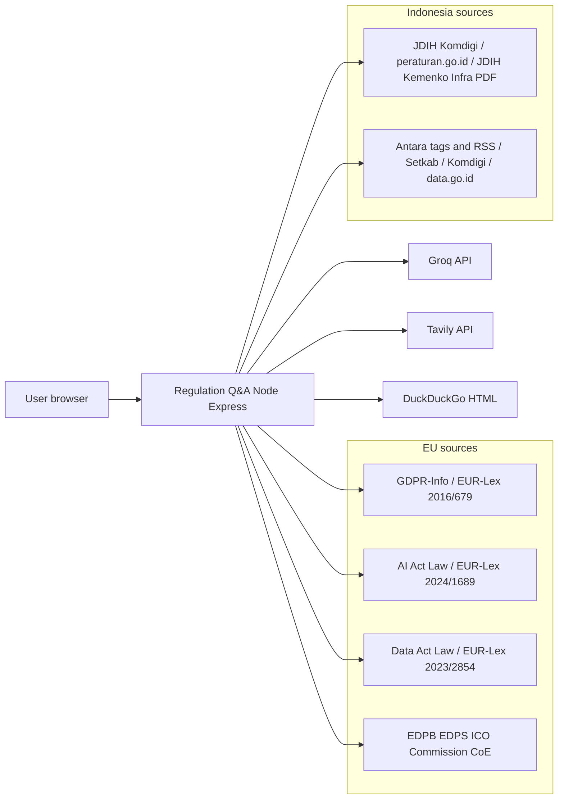
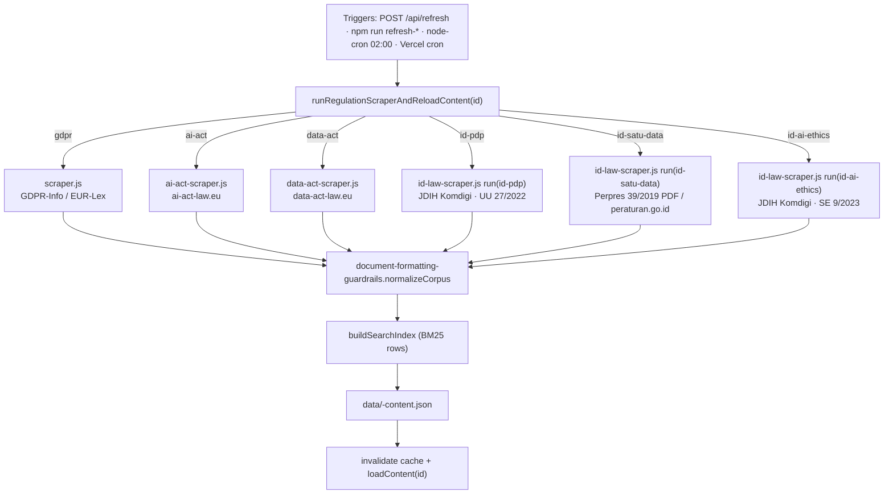
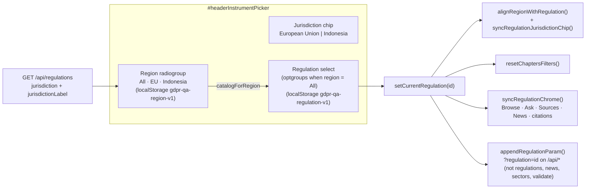
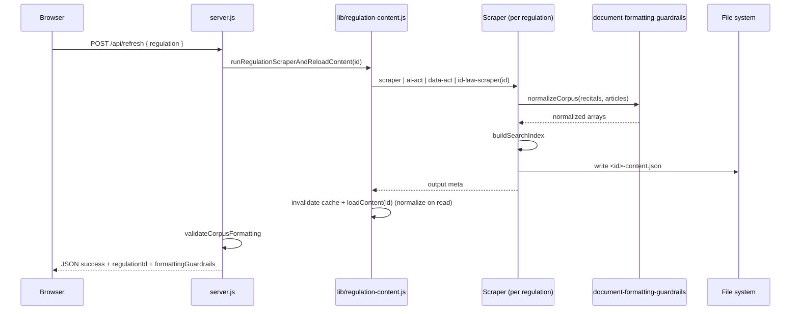
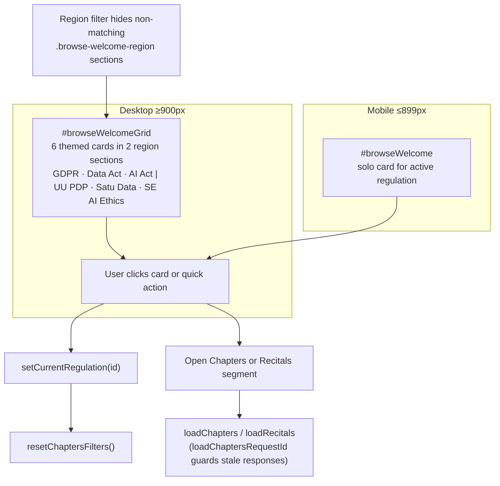
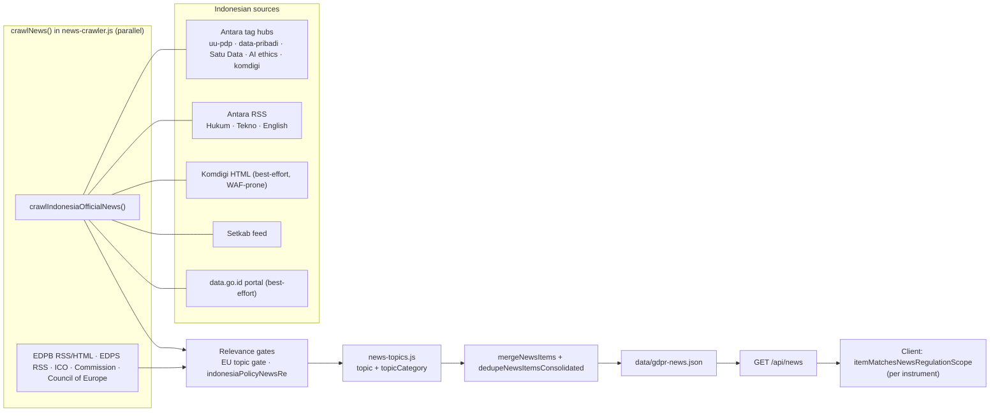
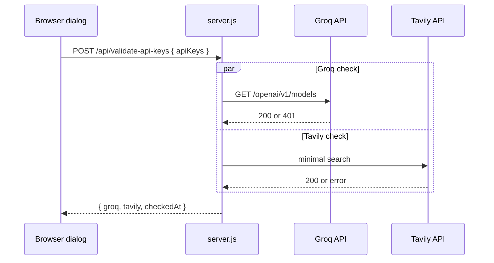

# Architecture overview  
## Regulation Q&A Platform

**Version:** 2.0 · **Last updated:** 2026-10-21 · Documentation standard **v2.6** · Product **1.2.7** · Audit date **2026-10-21**

The platform is a single Node.js/Express application serving a vanilla-JS SPA over **six instruments** in two jurisdictions (EU: `gdpr`, `ai-act`, `data-act`; Indonesia: `id-pdp`, `id-satu-data`, `id-ai-ethics`). There is **no database** and **no end-user authentication**.

## System context



---

## Logical architecture

| Layer | Components | Responsibility |
|-------|------------|----------------|
| **Client** | `index.html`, `app.js`, `regulation-profiles.js`, **`regulation-profiles-id.js`**, `news-dedupe.js`, `styles.css` | `#appChrome`; **region picker** (All / EU / Indonesia) + jurisdiction chip + regulation select; **Tools** panel; **browse welcome grid** (desktop, six cards) / solo card (mobile); chapters filter panel + `resetChaptersFilters`; News hero; regulation-aware Browse/Ask/Sources/News |
| **API** | `server.js` | REST; `parseRegulationId`; BM25; Groq/Tavily with `regulationSearchContext`; credible-source resolver; news merge |
| **Registry** | `lib/regulations.js`, `lib/regulation-content.js`, `lib/paths.js` | Six-entry registry (+ `jurisdiction`, `REGULATION_DISPLAY_ORDER`, `ID_REGULATION_IDS`); `loadContent(regId)`; ETL dispatch; Vercel `/tmp` + **`SEED_FILES`** (**20** JSON files) |
| **ETL GDPR** | `scraper.js` + **`document-formatting-guardrails.js`** | → `gdpr-content.json` |
| **ETL AI Act** | `ai-act-scraper.js` | → `ai-act-content.json` |
| **ETL Data Act** | `data-act-scraper.js` | → `data-act-content.json` |
| **ETL Indonesia (×3)** | **`id-law-scraper.js`** `run(id)` | → `id-pdp-content.json`, `id-satu-data-content.json`, `id-ai-ethics-content.json` (bundled official corpus preferred when live JDIH HTML is thin) |
| **ETL bootstrap (maintainer)** | `scripts/build-id-corpora.py` | One-off builder for Indonesian corpora from JDIH HTML + Perpres PDF (scratch dir `tmp-id-etl/`, git-ignored) |
| **News** | `news-crawler.js` (EU + `crawlIndonesiaOfficialNews`), `news-topics.js`, `server.js` (merge, dedupe, routes), `public/news-dedupe.js` | Parallel fetches (RSS/HTML/API) → relevance gate (EU topic gate + **Indonesian policy gate**) → topic assignment → merge → **consolidated dedupe** → API + client mirror |
| **Crossrefs** | `gdpr-crossrefs.js` | GDPR article↔recital suitability and citation extraction |
| **Tests** | `test/indo-parity.test.js` (`npm test`) | Registry, Indonesian corpora, news helpers, persisted Indonesian news |
| **Data** | `data/*.json` (20 files), `public/industry-sectors.json` | Corpora, structure, news cache, chapter summaries, sectors |

---

## Six ETL paths

Every instrument has exactly one ETL entry point, selected by `runRegulationScraperAndReloadContent(id)` (`lib/regulation-content.js`). All six paths run **`normalizeCorpus`** before `buildSearchIndex` and before writing JSON.



| # | Regulation id | ETL module | Output file | Structure file (credible sources, chapters) | npm script |
|---|---------------|-----------|-------------|---------------------------------------------|------------|
| 1 | `gdpr` | `scraper.js` | `gdpr-content.json` | `gdpr-structure.json` | `npm run refresh` |
| 2 | `ai-act` | `ai-act-scraper.js` | `ai-act-content.json` | `ai-act-structure.json` | `npm run refresh-ai-act` |
| 3 | `data-act` | `data-act-scraper.js` | `data-act-content.json` | `data-act-structure.json` | `npm run refresh-data-act` |
| 4 | `id-pdp` | `id-law-scraper.js id-pdp` | `id-pdp-content.json` | `id-pdp-structure.json` | `npm run refresh-id-pdp` |
| 5 | `id-satu-data` | `id-law-scraper.js id-satu-data` | `id-satu-data-content.json` | `id-satu-data-structure.json` | `npm run refresh-id-satu-data` |
| 6 | `id-ai-ethics` | `id-law-scraper.js id-ai-ethics` | `id-ai-ethics-content.json` | `id-ai-ethics-structure.json` | `npm run refresh-id-ai-ethics` |

### Indonesian ETL behaviour (`id-law-scraper.js`)

1. Load the structure file (chapters, `meta.sources`) and the existing content file.
2. Attempt a **live JDIH HTML fetch** (`fetchText`) and parse `Pasal N` blocks from plain text (`parsePasalFromPlainText`).
3. Use the live extract **only if** the bundled corpus is below `MIN_<PREFIX>_ARTICLES` / `_RECITALS`; otherwise **keep the bundled official corpus** (refresh then confirms source reachability and re-normalizes).
4. `mergeWithExisting` → `normalizeCorpus` → `buildSearchIndex` → hash compare (`computeDatasetHash`); write only when the hash changed, `<PREFIX>_FORCE_CORPUS_WRITE=1` / `GDPR_FORCE_CORPUS_WRITE=1`, the file is missing, or the index is empty.
5. `meta.etl.extractedFrom` ∈ `bundled-official`, `jdih-live`, `jdih-komdigi`, `jdih-kemenkoinfra-pdf`.
6. Throws (→ `POST /api/refresh` **500**) only when even the existing corpus falls below the minimum article count.

---

## Region picker and regulation selection (client flow)

The **region** is a **client-only** UX filter; the **regulation id** is what reaches the API.



- `defaultRegulationForRegion(region)` picks the first instrument for a region (`gdpr` for EU, `id-pdp` for Indonesia).
- `itemMatchesNewsRegulationScope` filters News client-side per instrument.
- Profiles: EU in `regulation-profiles.js`; Indonesian profiles in **`regulation-profiles-id.js`**, which extends `window.REGULATION_PROFILES` (and sets `officialSiteName`).

---

## Regulation refresh pipeline (sequence)



---

## Browse welcome (client flow)

When Browse shows the placeholder (no article/recital open), the client renders regulation overview UI from **`browseUi`** in `regulation-profiles.js` / `regulation-profiles-id.js`:



---

## Ask pipeline (sequence)

**Ask is `POST /api/answer` only.** There is no `/api/ask` or `/api/summarize` (removed 1.2.6).

```mermaid
sequenceDiagram
  participant UI as Browser
  participant S as server.js
  participant G as Groq API
  participant T as Tavily API
  participant W as Web (DDG + pages)

  UI->>S: POST /api/answer { query, regulation, industrySectorId, includeWeb, apiKeys? }
  Note over UI,S: apiKeys optional BYOK from localStorage
  S->>S: resolveLlmKeys + loadContent(regulation) + buildLocalContext (BM25)
  opt includeWeb
    S->>W: DuckDuckGo (regulationSearchContext suffix) + fetch excerpts
  end
  S->>G: chat/completions (grounded prompt; soft-law rule for id-ai-ethics)
  alt Groq OK
    G-->>S: answer text
  else Groq fails
    S->>T: search (optional, regulation prefix)
    T-->>S: answer or snippets
  else all fail
    S-->>S: buildSummaryFromExcerpts (extractive)
  end
  S-->>UI: JSON answer + sources + regulationId
```

---

## News pipeline (EU + Indonesia)



- Trusted Antara tag hubs skip the keyword gate; broad tags/RSS still require `indonesiaPolicyNewsRe`.
- Taxonomy categories added for Indonesia: **Indonesia Personal Data Protection**, **Indonesia Satu Data**, **Indonesia AI Ethics**.
- A single shared cache (`gdpr-news.json`) holds EU and Indonesian items; scope is applied in the browser.

---

## Deployment model

- **Local / VM** — One Node.js process (`npm start`) serves API and static files; `node-cron` runs daily ETL for **all six** instruments at 02:00 `Europe/Brussels`.
- **Vercel** — Express app exported via `api/index.js`; all routes rewrite to that function; bundled `data/` is seeded into `/tmp/gdpr-qa-data` per instance (`lib/paths.js` **`SEED_FILES`** manifest — **20** JSON files: six corpora, six structures, news, six chapter-summary files, GDPR suitable recitals). `vercel.json` `includeFiles` ships `data/**`, `ai-act-scraper.js`, `data-act-scraper.js`, **`id-law-scraper.js`**. Daily ETL uses Vercel Cron → `api/cron/daily-regulation-refresh.js` (all six, sequential) with `CRON_SECRET`. See [VERCEL_DEPLOY.md](VERCEL_DEPLOY.md).
- **Stateful files (local)** — `data/` should persist on disk between restarts (content + news cache). On Vercel, treat committed `data/` as source of truth; `/tmp` writes are ephemeral.
- **Secrets** — Environment variables only; no database required for core features. BYOK keys stay in the browser. **No end-user auth.**

---

## BYOK validation (sequence)



---

## Extension points

- **New regulation (either jurisdiction):** add an entry to `lib/regulations.js` (incl. `jurisdiction`, `jurisdictionLabel`, `officialSiteName`, `etlEnvPrefix`, `chapterRanges`), a structure + content JSON, a chapter-summaries file, add the files to `SEED_FILES`, add a profile (`regulation-profiles*.js`), and extend `REGULATION_DISPLAY_ORDER` / `BROWSE_WELCOME_GRID_ORDER`. For Indonesian instruments extend `ID_REGULATION_IDS` (so `id-law-scraper.js` accepts the id) and the `id-*` branch in `runRegulationScraperAndReloadContent`. Add the new id to the cron handler (`api/cron/daily-regulation-refresh.js`) and the `node-cron` block in `server.js`; touch `vercel.json` `includeFiles` only if a new scraper module is introduced. Add a test in `test/`.
- **New LLM provider for Ask:** Extend `server.js` with a parallel path to Groq/Tavily (keep citation contract; do **not** revive the removed `/api/summarize`).
- **BYOK providers:** Extend **`resolveLlmKeys`** and validation helpers; never persist client keys server-side.
- **Additional news sources:** Implement fetch/parser in `news-crawler.js` (add Indonesian feeds inside `crawlIndonesiaOfficialNews`) and add feed metadata to defaults or JSON.
- **Sector list:** Edit `public/industry-sectors.json` (and optional server copy if split later).

---

## References

- [API_CONTRACTS.md](API_CONTRACTS.md)  
- [VARIABLES.md](VARIABLES.md)  
- [SOURCE_CODE_INVENTORY.md](SOURCE_CODE_INVENTORY.md)  
- [README.md §8 Project structure](../README.md#8-project-structure)
