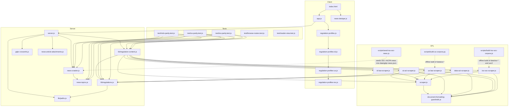

# Source code inventory  
## Regulation Q&A Platform

**Version:** 3.2 · **Last updated:** 2026-10-23 · Documentation standard **v3.2** · Product **1.3.0** · Audit date **2026-10-23**

Repository file map, **public module APIs**, and simplified dependency overview for **thirteen instruments** (EU: `gdpr`, `ai-act`, `data-act`; Indonesia: `id-pdp`, `id-satu-data`, `id-ai-ethics`; United States: `us-ccpa`, `us-open-data`, `us-admt`; International: `iso-27701`, `iso-19941`, `iso-23894`, `soc2`). For architecture diagrams, see [ARCHITECTURE.md](ARCHITECTURE.md).

Authoritative **file-by-file** map of the repository (excluding `node_modules/`, `.git/`). Use with [README §8](../README.md#8-project-structure) and [ARCHITECTURE.md](ARCHITECTURE.md).

---

## 1. Root application

| Path | Type | Responsibility |
|------|------|----------------|
| `server.js` | Backend | Express app: regulation APIs, Ask (`POST /api/answer` only), news, refresh, cron hooks, static SPA |
| `scraper.js` | ETL | GDPR corpus from GDPR-Info / EUR-Lex; shared ETL helpers reused by all other scrapers |
| `ai-act-scraper.js` | ETL | EU AI Act corpus from ai-act-law.eu |
| `data-act-scraper.js` | ETL | EU Data Act corpus from data-act-law.eu |
| **`id-law-scraper.js`** | ETL | **Indonesian corpora** (`id-pdp`, `id-satu-data`, `id-ai-ethics`): live JDIH HTML check (`Pasal` parsing), bundled-official corpus preferred when live extract is thin; CLI `node id-law-scraper.js <id>` |
| **`us-law-scraper.js`** | ETL | **United States analogue corpora** (`us-ccpa`, `us-admt`, `us-open-data`): `pingOfficialSource` confirms CPPA / Colorado General Assembly / govinfo reachability, keeps the bundled official corpus, applies `normalizeCorpus`, rebuilds `searchIndex`, writes only on hash change or force. Env `MIN_US_CCPA_*`, `MIN_US_ADMT_*`, `MIN_US_OPEN_DATA_*`, `US_*_FORCE_CORPUS_WRITE` (derived from `etlEnvPrefix`). CLI `node us-law-scraper.js <id>`; npm `refresh-us-ccpa`, `refresh-us-admt`, `refresh-us-open-data` |
| **`iso-soc-scraper.js`** | ETL | **International analogue corpora** (`iso-27701`, `iso-19941`, `iso-23894`, `soc2`): `pingOfficialSource` confirms ISO.org / AICPA & CIMA reachability (informational, >400 bytes) and keeps the **copyright-safe educational overlay** — **never scrapes paywalled ISO / AICPA body text**; applies `normalizeCorpus`, rebuilds `searchIndex`, writes only on hash change or force. Env derived from `etlEnvPrefix` (`ISO_27701`, `ISO_19941`, `ISO_23894`, `SOC2`): `MIN_<PREFIX>_ARTICLES` / `MIN_<PREFIX>_RECITALS` (mins 14/5, 11/4, 12/5, 20/6) and `<PREFIX>_FORCE_CORPUS_WRITE`. CLI `node iso-soc-scraper.js <id>`; npm `refresh-iso-27701`, `refresh-iso-19941`, `refresh-iso-23894`, `refresh-soc2`; builder `scripts/build-iso-soc-corpora.js` |
| `document-formatting-guardrails.js` | Library | Normalize + validate corpus on read/write — applies to **all thirteen** corpora including those written by `id-law-scraper.js`, `us-law-scraper.js`, and `iso-soc-scraper.js` |
| `gdpr-crossrefs.js` | Library | GDPR article↔recital suitability merge helpers |
| `news-crawler.js` | ETL | Multi-source news crawl and merge; EU publishers + **`crawlIndonesiaOfficialNews`** + **`crawlUnitedStatesOfficialNews`** (FTC, CPPA/CalPrivacy, California OAG, Colorado AG ADAI hub, data.gov / FDS / GSA) + **`crawlInternationalOfficialNews`** (ISO news / ISO Insights / AICPA catalogue seed + best-effort live search) |
| `news-topics.js` | Library | Topic taxonomy (EU + Indonesia + United States + International categories: 22 groups / 91 leaf labels), classification, crawl gate |
| `news-article-attachments.js` | Library | SSRF-safe attachment scan for news article URLs |
| `package.json` | Config | Version **1.3.0**; scripts (`start`, `refresh*`, `test`, …); dependencies; engine ≥18 |
| `package-lock.json` | Config | Locked dependency tree |
| `vercel.json` | Config | Rewrites, function limits, `includeFiles`, cron schedule |
| `.vercelignore` | Config | Deploy exclusions: `.env`, `.env.*` (except `.env.example`), `node_modules`, `*.log`, `.DS_Store`, `.cursor` |
| `.gitignore` | Config | `node_modules/`, `.env`, `*.log`, `.DS_Store`, `.vercel`, `tmp-id-etl/`, `tmp-us-etl/` |
| `.env.example` | Config | Documented environment template (no secrets) |
| `CHANGELOG.md`, `README.md`, `PRODUCT_DOCUMENTATION_STANDARD.md` | Docs | Root documentation set; see §8 |

### 1.1 Public module exports (Node)

| Module | Exported symbols | Consumers |
|--------|------------------|-----------|
| `server.js` | `app` (default), `runRegulationScraperAndReloadContent` | `api/index.js`, `api/cron/daily-regulation-refresh.js` |
| `scraper.js` | `run`, `fetchText`, `buildSearchIndex`, `stripLeadingHeadingLinesFromBody`, `mergeWithExisting`, `getGdprInfoEntryPlainText`, `computeDatasetHash` | `server.js`, `lib/regulation-content.js`, AI/Data Act and **Indonesian** scrapers |
| `ai-act-scraper.js` | `run` | `lib/regulation-content.js`, CLI |
| `data-act-scraper.js` | `run` | `lib/regulation-content.js`, CLI |
| **`id-law-scraper.js`** | `run(regulationId)` | `lib/regulation-content.js` (`id-pdp`, `id-satu-data`, `id-ai-ethics`), CLI |
| **`us-law-scraper.js`** | `run(regulationId)` | `lib/regulation-content.js` (`us-ccpa`, `us-admt`, `us-open-data`), CLI |
| **`iso-soc-scraper.js`** | `run(regulationId)` | `lib/regulation-content.js` (`iso-27701`, `iso-19941`, `iso-23894`, `soc2`), CLI |
| `document-formatting-guardrails.js` | `normalizeCorpus`, `validateCorpusFormatting`, `logFormattingGuardrailsReport` | All scrapers, `lib/regulation-content.js`, `server.js` |
| `gdpr-crossrefs.js` | `buildRecitalsCitingArticlesMap`, `mergedSuitableRecitalsForArticle`, `mergedSuitableArticlesForRecital` | `server.js` |
| `news-crawler.js` | `crawlNews`, **`indonesiaPolicyNewsRe`**, **`indonesiaNewsItemIsOnScope`**, **`unitedStatesPolicyNewsRe`**, **`unitedStatesNewsItemIsOnScope`**, **`internationalPolicyNewsRe`**, **`internationalNewsItemIsOnScope`**, **`internationalCatalogueNewsSeed`**, `newsItemMatchesApprovedTopic`, `withTimeout`, `normalizeNewsUrlKey`, `dedupeNewsItemsConsolidated`, `sanitizeNewsItemDates` | `server.js`, `scripts/seed-iso-soc-news.js`, `test/indo-parity.test.js`, `test/us-parity.test.js`, `test/iso-parity.test.js` (`crawlIndonesiaOfficialNews` / `crawlUnitedStatesOfficialNews` / `crawlInternationalOfficialNews` are internal to `crawlNews`) |
| `news-topics.js` | `NEWS_TOPIC_FALLBACK`, `assignNewsTopicFields`, `mergeNewsItemTopicFields`, `getTopicTaxonomyForClient`, `getFlatTopicLabelsInOrder`, `newsBlobMatchesTopicAnchor` | `server.js`, `news-crawler.js`, `scripts/seed-iso-soc-news.js`, `test/indo-parity.test.js`, `test/us-parity.test.js`, `test/iso-parity.test.js` |
| `news-article-attachments.js` | `fetchNewsArticleAttachments` | `server.js` |

**Note:** Internal helpers (e.g. `fetchUrl`, `parseEurLexText` in `scraper.js`; `parsePasalFromPlainText`, `fetchJdihDataset` in `id-law-scraper.js`; granular normalizers in `document-formatting-guardrails.js`) are **not** exported. Import only documented symbols (**TG-C01** in [GUARDRAILS.md](GUARDRAILS.md)).

---

## 2. `lib/`

| Path | Responsibility |
|------|----------------|
| `lib/regulations.js` | Thirteen-entry regulation registry (EU + Indonesia + `us-ccpa`, `us-admt`, `us-open-data` + International `iso-27701`, `iso-19941`, `iso-23894`, `soc2`): paths, limits, `jurisdiction`, feature flags, `REGULATION_DISPLAY_ORDER` |
| `lib/regulation-content.js` | `loadContent`, cache, `parseRegulationId`, refresh orchestration (ETL dispatch incl. `id-law-scraper`, `us-law-scraper`, and `iso-soc-scraper`) |
| `lib/paths.js` | `getDataDir()`, Vercel `/tmp` seeding (`SEED_FILES`, **41** files) |

### 2.1 `lib/regulations.js` — public API

| Export | Purpose |
|--------|---------|
| `normalizeRegulationId(id)` | Coerce query/body id to one of the thirteen ids (unknown ⇒ `gdpr`) |
| `getRegulation(id)` | Full registry object for one regulation |
| `listRegulations()` | API-safe list for `GET /api/regulations` in display order (includes `hasArticleTopics`, `hasSuitableRecitals`, `jurisdiction`, `jurisdictionLabel`, `officialSiteName`) |
| `getRegulationPaths(id)` | Resolved filesystem paths under `getDataDir()` |
| `enrichArticlesWithChapter(articles, chapterRanges)` | Attach `chapter` index to articles (ETL and load) |
| `ID_REGULATION_IDS` | `Set` of the three Indonesian ids (`id-pdp`, `id-satu-data`, `id-ai-ethics`) |
| `US_REGULATION_IDS` | `Set` of the three United States analogue ids (`us-ccpa`, `us-admt`, `us-open-data`) |
| `INTL_REGULATION_IDS` | `Set` of the four International ids (`iso-27701`, `iso-19941`, `iso-23894`, `soc2`) — gates `iso-soc-scraper.js` and the no-GDPR-fallback rule |

**Internal (not exported):** `REGULATIONS` constant, `REGULATION_DISPLAY_ORDER`. Feature flags and jurisdiction live on registry objects:

| Regulation | Jurisdiction | `hasArticleTopics` | `hasSuitableRecitals` | `etlEnvPrefix` | Max articles / recitals / chapters |
|------------|:------------:|:------------------:|:---------------------:|----------------|-------------------------------------|
| `gdpr` | `eu` | `true` | `true` | `GDPR` | 99 / 173 / 11 |
| `ai-act` | `eu` | `false` | `false` | `AI_ACT` | 113 / 180 / 13 |
| `data-act` | `eu` | `false` | `false` | `DATA_ACT` | 50 / 119 / 11 |
| `id-pdp` | `id` | `false` | `false` | `ID_PDP` | 76 / 4 / 16 |
| `id-satu-data` | `id` | `false` | `false` | `ID_SATU_DATA` | 44 / 4 / 8 |
| `id-ai-ethics` | `id` | `false` | `false` | `ID_AI_ETHICS` | 7 / 9 / 5 |
| `us-ccpa` | `us` | `false` | `false` | `US_CCPA` | 33 / 5 / 7 |
| `us-admt` | `us` | `false` | `false` | `US_ADMT` | 14 / 5 / 7 |
| `us-open-data` | `us` | `false` | `false` | `US_OPEN_DATA` | 10 / 4 / 5 |
| `iso-27701` | `intl` | `false` | `false` | `ISO_27701` | 14 / 5 / 4 |
| `iso-19941` | `intl` | `false` | `false` | `ISO_19941` | 11 / 4 / 4 |
| `iso-23894` | `intl` | `false` | `false` | `ISO_23894` | 12 / 5 / 5 |
| `soc2` | `intl` | `false` | `false` | `SOC2` | 20 / 6 / 5 |

### 2.2 `lib/paths.js` — public API and Vercel seed

| Export | Purpose |
|--------|---------|
| `getDataDir()` | Writable data directory (`data/` locally; `/tmp/gdpr-qa-data` on Vercel) |
| `IS_VERCEL` | `Boolean(process.env.VERCEL)` — gates tmp seeding |

**`SEED_FILES` (internal, 41 files)** — copied from bundled `data/` to `/tmp` on first cold start when destination missing:

| # | File | # | File |
|---|------|---|------|
| 1 | `gdpr-content.json` | 22 | `iso-19941-structure.json` |
| 2 | `gdpr-structure.json` | 23 | `iso-23894-content.json` |
| 3 | `ai-act-content.json` | 24 | `iso-23894-structure.json` |
| 4 | `ai-act-structure.json` | 25 | `soc2-content.json` |
| 5 | `data-act-content.json` | 26 | `soc2-structure.json` |
| 6 | `data-act-structure.json` | 27 | `gdpr-news.json` |
| 7 | `id-pdp-content.json` | 28 | `chapter-summaries.json` |
| 8 | `id-pdp-structure.json` | 29 | `chapter-summaries-ai-act.json` |
| 9 | `id-satu-data-content.json` | 30 | `chapter-summaries-data-act.json` |
| 10 | `id-satu-data-structure.json` | 31 | `chapter-summaries-id-pdp.json` |
| 11 | `id-ai-ethics-content.json` | 32 | `chapter-summaries-id-satu-data.json` |
| 12 | `id-ai-ethics-structure.json` | 33 | `chapter-summaries-id-ai-ethics.json` |
| 13 | `us-ccpa-content.json` | 34 | `chapter-summaries-us-ccpa.json` |
| 14 | `us-ccpa-structure.json` | 35 | `chapter-summaries-us-admt.json` |
| 15 | `us-admt-content.json` | 36 | `chapter-summaries-us-open-data.json` |
| 16 | `us-admt-structure.json` | 37 | `chapter-summaries-iso-27701.json` |
| 17 | `us-open-data-content.json` | 38 | `chapter-summaries-iso-19941.json` |
| 18 | `us-open-data-structure.json` | 39 | `chapter-summaries-iso-23894.json` |
| 19 | `iso-27701-content.json` | 40 | `chapter-summaries-soc2.json` |
| 20 | `iso-27701-structure.json` | 41 | `article-suitable-recitals.json` |
| 21 | `iso-19941-content.json` | | |

Override writable root with `GDPR_DATA_DIR`. See [VERCEL_DEPLOY.md](VERCEL_DEPLOY.md).

### 2.3 `lib/regulation-content.js` — public API

| Export | Purpose |
|--------|---------|
| `parseRegulationId(req)` | Read `regulation` from query or body |
| `loadContent(regulationId)` | Cached corpus + `buildSearchIndex` on read |
| `runRegulationScraperAndReloadContent(regulationId)` | Dispatch to the right scraper (`scraper` / `ai-act` / `data-act` / `id-law-scraper` / `us-law-scraper` / `iso-soc-scraper`), invalidate cache, reload |
| `listRegulations()` | Re-export from `lib/regulations.js` |
| `getRegulationPaths(id)` | Re-export from `lib/regulations.js` |

`invalidateRegulationContentCache` is **module-internal** (removed from the public API in 1.2.6).

---

## 3. `api/` (Vercel)

| Path | Responsibility |
|------|----------------|
| `api/index.js` | Serverless Express entry (`module.exports = require('../server')`) |
| `api/cron/daily-regulation-refresh.js` | Scheduled ETL for **all thirteen** instruments (sequential); `CRON_SECRET` auth; response keys `gdpr`, `aiAct`, `dataAct`, `idPdp`, `idSatuData`, `idAiEthics`, `usCcpa`, `usAdmt`, `usOpenData`, `iso27701`, `iso19941`, `iso23894`, `soc2` |

---

## 4. `public/` (frontend)

| Path | Responsibility |
|------|----------------|
| `public/index.html` | SPA shell: `#appChrome`, **`#headerInstrumentPicker`** (`#regionFilter`, `#regulationJurisdictionChip`, `#regulationSelect`), Tools panel, **`#browseWelcomeGrid`** / **`#browseWelcome`**, **`#chaptersFiltersToggle`** / panel, **`#newsSections`**, News hero, app credits |
| `public/app.js` | Browse, Ask, Sources, News, BYOK; **region picker** (`catalogForRegion`, `alignRegionWithRegulation`); regulation chrome; chapters filter panel; reader formatting; per-instrument news scope regexes |
| `public/styles.css` | Design tokens, app chrome, region filter, browse welcome themes, News hero themes (thirteen accents: three EU, three Indonesia, three US, four International), region thumb for `all` / `eu` / `id` / `us` / `intl`, reader layout |
| `public/regulation-profiles.js` | EU per-regulation UI: `askUi`, `sourcesUi`, `newsUi`, `browseUi`, `citationsUi`, URLs |
| **`public/regulation-profiles-id.js`** | Indonesian profiles (`id-pdp`, `id-satu-data`, `id-ai-ethics`) — extends `REGULATION_PROFILES`; sets `officialSiteName`; soft-law copy for SE AI Ethics |
| **`public/regulation-profiles-us.js`** | United States profiles (`us-ccpa`, `us-open-data`, `us-admt`) — extends `REGULATION_PROFILES`; `CCPA § N` / `OPEN Data § N` / `ADMT § N` headings, `Purpose note (N)`, `officialSiteName` (California Legislative Information, govinfo, Colorado General Assembly); US honesty copy (no federal GDPR/AI Act; not the 2014 DATA Act) |
| **`public/regulation-profiles-iso.js`** | International profiles (`iso-27701`, `iso-19941`, `iso-23894`, `soc2`) — extends `REGULATION_PROFILES`; Clause / Criterion + Purpose-note headings; ISO.org / AICPA official sites; honesty copy (voluntary standards, not laws; 19941-1 forthcoming; 23894 ≠ 42001 ≠ AI Act; SOC 2 Type 1/2) |
| `public/news-dedupe.js` | Client mirror of `dedupeNewsItemsConsolidated` (`GDPR_NEWS_DEDUPE`) |
| `public/industry-sectors.json` | ISIC sector list for Ask |
| `public/industry-sector-tree.json` | Hierarchical sector tree |
| `public/article-suitable-recitals.json` | GDPR editorial crossrefs (prestart copy) |

### 4.1 Removed legacy client symbols (2026-07-06)

The following were removed as dead code; **no user-facing feature loss**:

| Removed | Reason |
|---------|--------|
| `openChapter()` | No call sites; chapter browsing uses grouped list + article detail |
| `buildClientSummary()` | Ask error path never invoked it |
| `normalizeAnswerText()` | Unused; `formatAnswerHtml` handles display |
| `renderNumericSublist()` | Deprecated wrapper with zero callers |
| `#newsList` flat list path | Replaced by `#newsSections` grouped UI |

### 4.2 Removed legacy CSS (2026-07-06)

`.chapter-view*`, `.chapter-card`, `.browse-welcome-hint`, legacy `.qa-*` / `.chat-*` / `.result-card` Ask blocks, hidden `.news-filter-label` rules.

### 4.3 Removed server routes and helpers (1.2.6)

`GET /api/categories`, `GET /api/chapters/:number`, `POST /api/ask`, `POST /api/summarize`, and the unused multi-provider summarize helpers (OpenAI / Anthropic / Gemini / Mistral / OpenRouter). Ask remains Groq → Tavily → extractive via `POST /api/answer`. See [API_CONTRACTS.md](API_CONTRACTS.md).

---

## 5. `data/` (persisted — 41 JSON files)

| Path | Regulation / domain |
|------|---------------------|
| `data/gdpr-structure.json` | GDPR structure + credible sources |
| `data/gdpr-content.json` | GDPR full corpus |
| `data/ai-act-structure.json` | AI Act structure + credible sources |
| `data/ai-act-content.json` | AI Act full corpus |
| `data/data-act-structure.json` | Data Act structure + credible sources |
| `data/data-act-content.json` | Data Act full corpus |
| **`data/id-pdp-structure.json`** | UU PDP structure (16 BAB) + credible sources (JDIH Komdigi, peraturan.go.id, JDIH Kemenko Infra, JDIH Kemenkeu) |
| **`data/id-pdp-content.json`** | UU PDP corpus (76 Pasal, 4 menimbang) |
| **`data/id-satu-data-structure.json`** | Satu Data structure (8 BAB) + sources (peraturan.go.id, JDIH PDF, Setkab, data.go.id) |
| **`data/id-satu-data-content.json`** | Perpres 39/2019 corpus (44 Pasal, 4 menimbang) |
| **`data/id-ai-ethics-structure.json`** | SE AI Ethics structure (5 chapters) + sources (JDIH Komdigi, RPerpres notice) |
| **`data/id-ai-ethics-content.json`** | SE 9/2023 corpus (7 sections, 9 ethical values) |
| `data/us-ccpa-structure.json` | CCPA/CPRA structure (7 chapters) + CPPA / leginfo sources |
| `data/us-ccpa-content.json` | CCPA/CPRA corpus (33 articles, 5 recitals) |
| `data/us-admt-structure.json` | Colorado ADMT structure (7 chapters) + session-law sources |
| `data/us-admt-content.json` | SB 26-189 corpus (14 articles, 5 recitals) |
| `data/us-open-data-structure.json` | OPEN Data structure (5 chapters) + govinfo / data.gov sources |
| `data/us-open-data-content.json` | Title II of P.L. 115-435 (10 articles, 4 recitals) |
| `data/iso-27701-structure.json` | ISO 27701 structure (4 chapters) + ISO.org / JTC 1 SC 27 sources |
| `data/iso-27701-content.json` | ISO/IEC 27701:2025 PIMS educational overlay (14 clauses, 5 purpose notes) |
| `data/iso-19941-structure.json` | ISO 19941 structure (4 chapters) + ISO.org / ISO/IEC 17788–17789 sources |
| `data/iso-19941-content.json` | ISO/IEC 19941:2017 cloud interoperability overlay (11 clauses, 4 purpose notes) |
| `data/iso-23894-structure.json` | ISO 23894 structure (5 chapters) + ISO.org / ISO/IEC 42001 (related) / JTC 1 SC 42 sources |
| `data/iso-23894-content.json` | ISO/IEC 23894:2023 AI risk-management overlay (12 clauses, 5 purpose notes) |
| `data/soc2-structure.json` | SOC 2 structure (5 chapters) + AICPA TSC / SOC for Service Organizations sources |
| `data/soc2-content.json` | AICPA Trust Services Criteria overlay (20 criteria, 6 purpose notes) |
| `data/gdpr-news.json` | News feeds + items (shared across all instruments; EU + Indonesian + United States + International) |
| `data/article-suitable-recitals.json` | GDPR editorial crossrefs |
| `data/chapter-summaries.json` | GDPR chapter intros |
| `data/chapter-summaries-ai-act.json` | AI Act chapter intros |
| `data/chapter-summaries-data-act.json` | Data Act chapter intros |
| **`data/chapter-summaries-id-pdp.json`** | UU PDP chapter intros |
| **`data/chapter-summaries-id-satu-data.json`** | Satu Data chapter intros |
| **`data/chapter-summaries-id-ai-ethics.json`** | SE AI Ethics chapter intros |
| **`data/chapter-summaries-us-ccpa.json`** | US CCPA chapter intros |
| **`data/chapter-summaries-us-admt.json`** | Colorado ADMT chapter intros |
| **`data/chapter-summaries-us-open-data.json`** | OPEN Data chapter intros |
| **`data/chapter-summaries-iso-27701.json`** | ISO 27701 chapter intros |
| **`data/chapter-summaries-iso-19941.json`** | ISO 19941 chapter intros |
| **`data/chapter-summaries-iso-23894.json`** | ISO 23894 chapter intros |
| **`data/chapter-summaries-soc2.json`** | SOC 2 chapter intros |

All 41 files are in the `SEED_FILES` manifest (`lib/paths.js`). Each `*-content.json` has the shape `meta` · `categories` · `chapters` · `articles` · `recitals` · `searchIndex` (see [DATA_SCHEMA_EXAMPLES.md](DATA_SCHEMA_EXAMPLES.md)).

---

## 6. `scripts/` and scratch

| Path | Responsibility |
|------|----------------|
| `scripts/fetch-article-suitable-recitals.js` | Refresh GDPR suitable-recitals map (`npm run fetch-suitable-recitals`) |
| `scripts/generate-industry-sectors-isic.js` | Maintainer one-off: regenerate `public/industry-sectors.json` |
| **`scripts/build-id-corpora.py`** | Maintainer one-off (Python 3): builds the three Indonesian corpora/structures from JDIH Komdigi HTML and the official Perpres 39/2019 PDF text; reads scratch files from `tmp-id-etl/`; contains a machine-local scratch path constant — review before running elsewhere |
| **`scripts/build-us-corpora.py`** | Maintainer one-off (Python 3): builds the three United States analogue corpora from CPPA PDF extract, Colorado session-law HTML, and govinfo P.L. 115-435; scratch in `tmp-us-etl/` |
| **`scripts/build-iso-soc-corpora.js`** | Maintainer builder: copyright-safe ISO/SOC 2 educational overlays (ISO.org abstracts + HLS / ISO 31000 / AICPA TSC category names); never copies paid standard text |
| **`scripts/seed-iso-soc-news.js`** | Merges ISO.org / AICPA catalogue notices into `data/gdpr-news.json` |
| `tmp-id-etl/` | **Git-ignored** scratch dir holding downloaded Indonesian PDFs/text; listed in `.gitignore` and `.vercelignore` |
| `tmp-us-etl/` | **Git-ignored** scratch dir holding downloaded US official extracts; listed in `.gitignore` and `.vercelignore` |

---

## 7. `test/` (automated tests)

| Path | Responsibility |
|------|----------------|
| **`test/indo-parity.test.js`** | Node built-in test runner (`node --test`). Suites: Indonesian regulation registry; Indonesian corpora for Ask/Browse; Indonesian news helpers; persisted news corpus (Antara / Satu Data). |
| **`test/us-parity.test.js`** | United States registry, corpora/sources (CCPA / ADMT / OPEN Data, not 2014 DATA Act), news helpers, Ask `buildLocalContext` retrieval, `resolveCredibleSourcesForRegulation` no GDPR-Info fallback. |
| **`test/iso-parity.test.js`** | International registry, copyright-safe corpora/sources (ISO 27701 / 19941 / 23894 / SOC 2), news helpers, Ask retrieval, no GDPR-Info fallback. |
| **`test/browse-routes.test.js`** | Guards browse hash routing: real provision hashes (not `href="#"`), `activateBrowseRegulationSegment` without home-tab click, `suppressAppRouteSync` batching, deep-link / bounce hardening. |
| **`test/reader-view.test.js`** | Reader **Page \| Full**: GDPR corpus shape for Full render; `#readerViewMode` radiogroup markup; related chrome expectations. |
| **Test suite (aggregate)** | `npm test` → all `test/*.test.js` (**58 tests / 24 suites / 0 failures** as of 2026-10-23). Expect all five files green before merge. |

Run: `npm test` (→ `node --test test/*.test.js`). There is currently no browser/E2E harness; UI behaviour is verified with the manual checklists in [TECH_GUIDELINES.md](TECH_GUIDELINES.md) §10 and [OPERATIONS_RUNBOOK.md](OPERATIONS_RUNBOOK.md) §6.

---

## 8. Configuration, deploy, documentation

| Path | Responsibility |
|------|----------------|
| `.env.example` | Documented environment template |
| `vercel.json` | Rewrites, cron (`0 2 * * *`), `includeFiles: data/**,ai-act-scraper.js,data-act-scraper.js,id-law-scraper.js,us-law-scraper.js,iso-soc-scraper.js` (both `api/index.js` and `api/cron/daily-regulation-refresh.js`) |
| `.vercelignore` | Deploy exclusions (see §1) |
| `docs/` | Product documentation (see [docs/README.md](README.md)); root `README.md`, `PRODUCT_DOCUMENTATION_STANDARD.md`, `CHANGELOG.md` |

---

## 9. Dependency graph (simplified)

