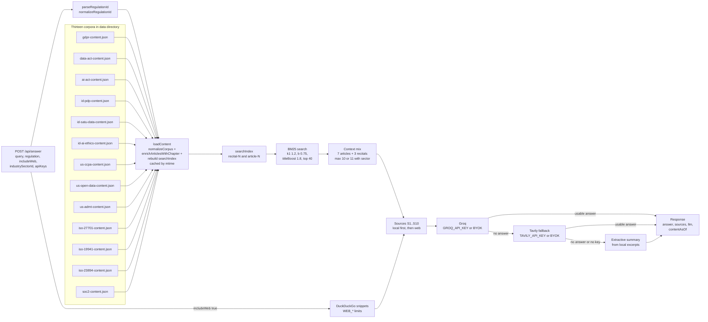
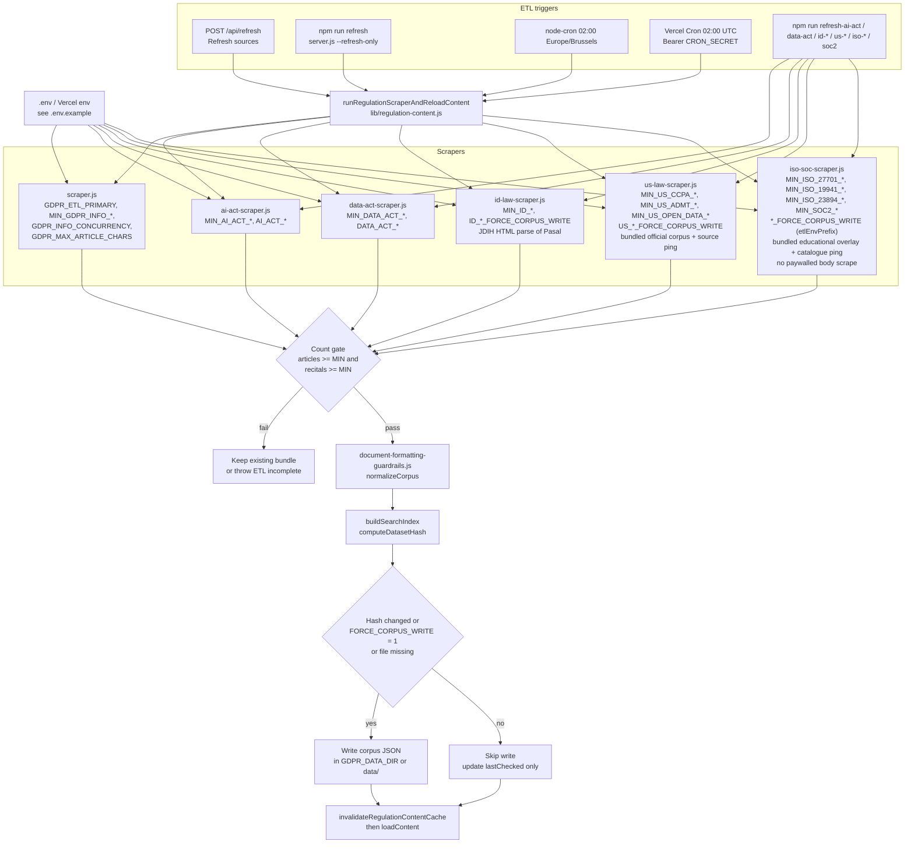
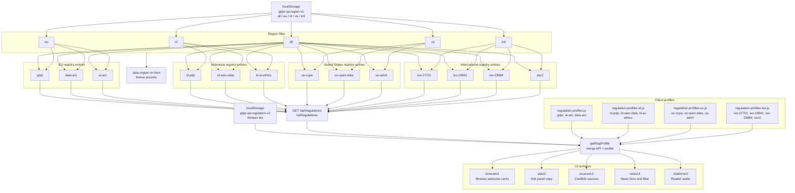
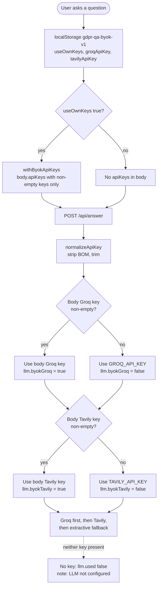
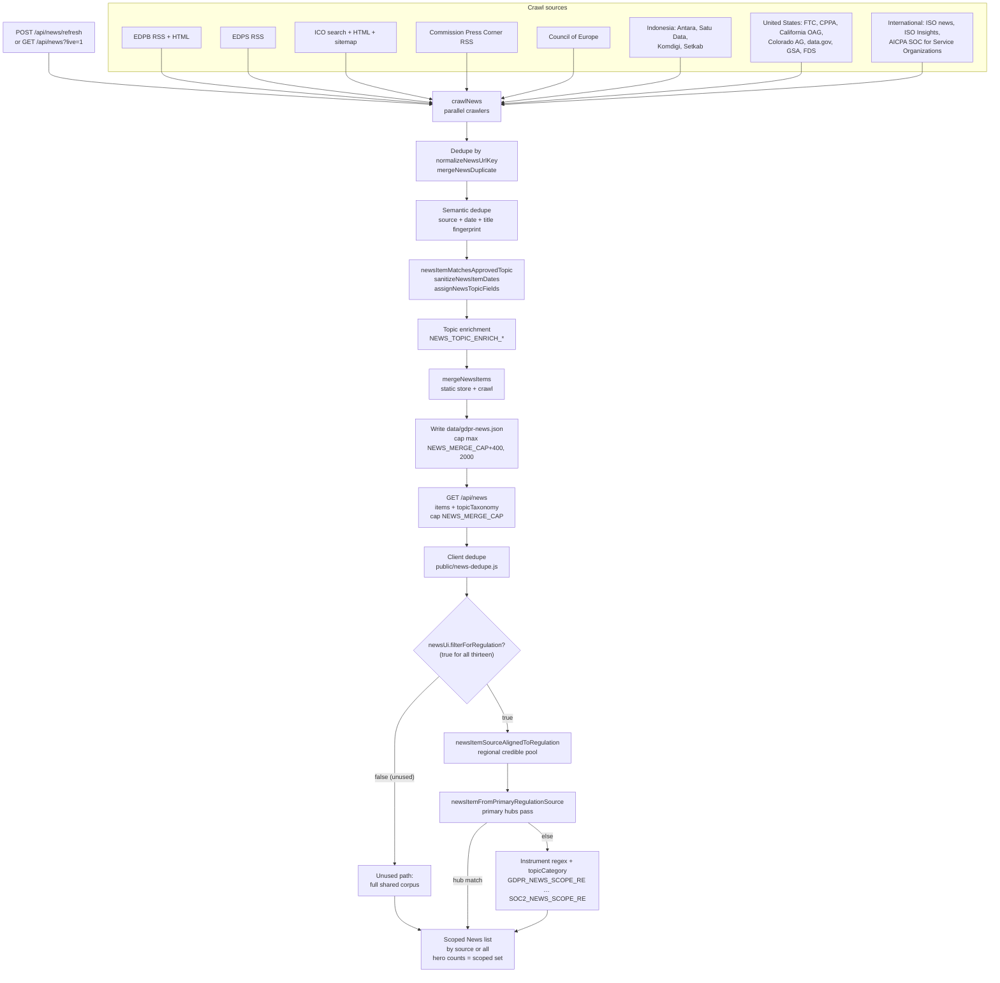
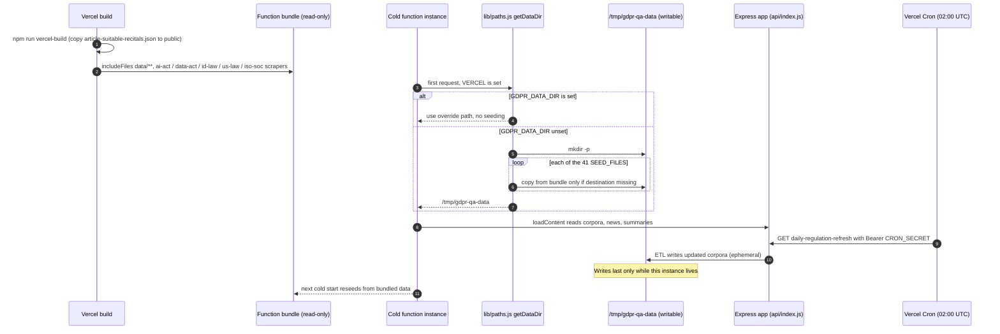

# Variables and data dictionary
## Regulation Q&A Platform (EU, Indonesia, United States, and International)

**Document version:** 3.2 · **Product version:** `package.json` **1.3.0** · **Documentation standard:** **v3.2** · **Audit date:** **2026-10-23** · **Instruments:** thirteen (EU + Indonesia + United States + International) · **`SEED_FILES`:** 41

**Scope:** Environment variables, bundled data files, regulation registry and UI profile fields, corpus JSON shapes, Ask API and BYOK fields, news item fields and topic taxonomy, app-chrome CSS variables, and relationship diagrams.

**Cross-references**

| Document | Purpose |
|----------|---------|
| [../README.md](../README.md) | Operator handbook: overview, features, quick start, configuration summary. |
| [API_CONTRACTS.md](API_CONTRACTS.md) | REST request and response contracts (`/api/answer`, `/api/news`, `/api/regulations`, and others). |
| [DOCUMENT_FORMATTING_GUARDRAILS.md](DOCUMENT_FORMATTING_GUARDRAILS.md) | Binding contract between ETL output, JSON corpora, and the reader (`normalizeCorpus`). |
| [../.env.example](../.env.example) | Authoritative list of supported environment variables (all commented by default). |
| [VERCEL_DEPLOY.md](VERCEL_DEPLOY.md) | Production deployment, cron, and environment setup on Vercel. |
| [DATA_SCHEMA_EXAMPLES.md](DATA_SCHEMA_EXAMPLES.md) | Illustrative JSON payloads for corpora, Ask, and news. |
| [DESIGN_GUIDELINES.md](DESIGN_GUIDELINES.md) | Visual system, theme accents, and app chrome standards. |
| [GUARDRAILS.md](GUARDRAILS.md) | Business, technical, and design limitations. |

---

## Table of contents

1. [Environment and server configuration](#1-environment-and-server-configuration)
   - [1.1 SEED_FILES (bundled cold-start data)](#11-seed_files-bundled-cold-start-data)
   - [1.2 Server and runtime](#12-server-and-runtime)
   - [1.3 GDPR ETL](#13-gdpr-etl)
   - [1.4 EU AI Act ETL](#14-eu-ai-act-etl)
   - [1.5 EU Data Act ETL](#15-eu-data-act-etl)
   - [1.6 Indonesian ETL](#16-indonesian-etl)
   - [1.6a United States ETL](#16a-united-states-etl)
   - [1.6b International ISO / SOC 2 ETL](#16b-international-iso--soc-2-etl)
   - [1.7 Ask: web snippet retrieval](#17-ask-web-snippet-retrieval)
   - [1.8 Groq](#18-groq)
   - [1.9 Tavily](#19-tavily)
   - [1.10 News crawl and merge](#110-news-crawl-and-merge)
   - [1.11 News topic enrichment](#111-news-topic-enrichment)
   - [1.12 Commission RSS](#112-commission-rss)
   - [1.13 Platform-detected variables](#113-platform-detected-variables)
   - [1.14 Documentation notes on defaults](#114-documentation-notes-on-defaults)
2. [Regulation selection](#2-regulation-selection)
3. [UI profiles](#3-ui-profiles)
4. [Corpus field shapes](#4-corpus-field-shapes)
5. [Ask API and BYOK](#5-ask-api-and-byok)
6. [News](#6-news)
7. [App chrome CSS variables](#7-app-chrome-css-variables)
8. [Relationship diagrams](#8-relationship-diagrams)
9. [Maintenance checklist](#9-maintenance-checklist)

---

## Conventions

| Convention | Meaning |
|------------|---------|
| **Technical name** | Exact identifier in code, JSON, HTTP, or the environment. |
| **Formula / rule** | Parsing, default, clamp, or derivation logic as implemented. |
| **Clamp `[a, b]`** | Value is forced into the inclusive range after parsing. |
| **Default** | Value used when the variable is unset, empty, or not a valid number. |
| **Secret** | Never commit, log, or paste real values. See [Secrets handling](#secrets-handling). |
| **File paths** | Relative to the repository root `gdpr-qa-platform/` unless stated otherwise. |

### Secrets handling

- `.env` is ignored by Git and Vercel upload (`.gitignore`, `.vercelignore`); only `.env.example` is tracked.
- Set production values in **Vercel → Project → Settings → Environment Variables**.
- Variables that hold secrets in this document: `CRON_SECRET`, `GROQ_API_KEY`, `TAVILY_API_KEY`, and the BYOK keys stored in the browser.

---

## 1. Environment and server configuration

Variables are loaded by `dotenv` in `server.js` from the first existing file among `./.env`, `<cwd>/.env`, and `<cwd>/gdpr-qa-platform/.env`. Every variable below is **optional** unless stated; defaults are listed.

### 1.1 SEED_FILES (bundled cold-start data)

`SEED_FILES` is the array in `lib/paths.js` that lists every file copied from the bundled `data/` folder into the writable data directory on Vercel. Copy rule: **copy only when the destination file does not exist** (`seedBundledDataTo`).

| # | Technical name (file in `data/`) | Friendly name | Definition | Formula / rule | Location in app | Example |
|---|----------------------------------|---------------|------------|----------------|-----------------|---------|
| 1 | `gdpr-content.json` | GDPR corpus | Full GDPR articles, recitals, chapters, and `searchIndex`. | Read by `loadContent('gdpr')`; written by `scraper.js`. | `lib/regulation-content.js`, `scraper.js` | 99 articles, 173 recitals |
| 2 | `gdpr-structure.json` | GDPR structure skeleton | Chapters, categories, and credible-source metadata used as fallback and ETL skeleton. | Fallback when content file is missing or unparsable. | `scraper.js`, `server.js` (credible sources fallback) | 11 chapters |
| 3 | `ai-act-content.json` | EU AI Act corpus | AI Act articles, recitals, chapters, and `searchIndex`. | Written by `ai-act-scraper.js`. | `lib/regulation-content.js` | 113 articles, 180 recitals |
| 4 | `ai-act-structure.json` | EU AI Act structure skeleton | Chapter and source metadata skeleton. | ETL input and fallback. | `ai-act-scraper.js` | 13 chapters |
| 5 | `data-act-content.json` | EU Data Act corpus | Data Act articles, recitals, chapters, and `searchIndex`. | Written by `data-act-scraper.js`. | `lib/regulation-content.js` | 50 articles, 119 recitals |
| 6 | `data-act-structure.json` | EU Data Act structure skeleton | Chapter and source metadata skeleton. | ETL input and fallback. | `data-act-scraper.js` | 11 chapters |
| 7 | `id-pdp-content.json` | UU PDP corpus | Pasal (articles), Menimbang (considering clauses), chapters, `searchIndex`. | Written by `id-law-scraper.js id-pdp`. | `lib/regulation-content.js` | 76 pasal, 4 considering |
| 8 | `id-pdp-structure.json` | UU PDP structure skeleton | Chapters, categories, and sources. | ETL input and fallback. | `id-law-scraper.js` | 16 chapters |
| 9 | `id-satu-data-content.json` | Satu Data corpus | Perpres 39/2019 pasal, considering clauses, chapters, `searchIndex`. | Written by `id-law-scraper.js id-satu-data`. | `lib/regulation-content.js` | 44 pasal, 4 considering |
| 10 | `id-satu-data-structure.json` | Satu Data structure skeleton | Chapters, categories, and sources. | ETL input and fallback. | `id-law-scraper.js` | 8 chapters |
| 11 | `id-ai-ethics-content.json` | ID AI Ethics corpus | SE Menkominfo 9/2023 sections, ethical values, chapters, `searchIndex`. | Written by `id-law-scraper.js id-ai-ethics`. | `lib/regulation-content.js` | 7 sections, 9 values |
| 12 | `id-ai-ethics-structure.json` | ID AI Ethics structure skeleton | Chapters, categories, and sources. | ETL input and fallback. | `id-law-scraper.js` | 5 chapters |
| 13 | `us-ccpa-content.json` | US CCPA/CPRA corpus | Civil Code §§ 1798.100–1798.199.95 articles, recitals, chapters, `searchIndex`. | Written by `us-law-scraper.js us-ccpa`. | `lib/regulation-content.js` | 33 articles, 5 recitals |
| 14 | `us-ccpa-structure.json` | US CCPA structure skeleton | Chapters, categories, and sources (CPPA, leginfo). | ETL input and fallback. | `us-law-scraper.js` | 7 chapters |
| 15 | `us-admt-content.json` | Colorado ADMT corpus | SB 26-189 / C.R.S. 6-1-1701 et seq. | Written by `us-law-scraper.js us-admt`. | `lib/regulation-content.js` | 14 articles, 5 recitals |
| 16 | `us-admt-structure.json` | Colorado ADMT structure skeleton | Chapters, categories, and sources (Colorado session laws). | ETL input and fallback. | `us-law-scraper.js` | 7 chapters |
| 17 | `us-open-data-content.json` | OPEN Government Data Act corpus | Title II of Pub. L. 115-435 (not the 2014 DATA Act). | Written by `us-law-scraper.js us-open-data`. | `lib/regulation-content.js` | 10 articles, 4 recitals |
| 18 | `us-open-data-structure.json` | OPEN Data structure skeleton | Chapters, categories, and sources (govinfo, data.gov). | ETL input and fallback. | `us-law-scraper.js` | 5 chapters |
| 19 | `iso-27701-content.json` | ISO 27701 corpus | ISO/IEC 27701:2025 (standalone PIMS) clause map and purpose notes — copyright-safe educational overlay. | Built by `scripts/build-iso-soc-corpora.js`; refreshed (ping-only) by `iso-soc-scraper.js iso-27701`. | `lib/regulation-content.js` | 14 clauses, 5 purpose notes |
| 20 | `iso-27701-structure.json` | ISO 27701 structure skeleton | Chapters, categories, and official-source metadata (ISO.org / AICPA). | ETL input and fallback. | `iso-soc-scraper.js` | 4 chapters |
| 21 | `iso-19941-content.json` | ISO 19941 corpus | ISO/IEC 19941:2017 cloud interoperability and portability clause map and purpose notes. | Built by `scripts/build-iso-soc-corpora.js`; refreshed (ping-only) by `iso-soc-scraper.js iso-19941`. | `lib/regulation-content.js` | 11 clauses, 4 purpose notes |
| 22 | `iso-19941-structure.json` | ISO 19941 structure skeleton | Chapters, categories, and official-source metadata (ISO.org / AICPA). | ETL input and fallback. | `iso-soc-scraper.js` | 4 chapters |
| 23 | `iso-23894-content.json` | ISO 23894 corpus | ISO/IEC 23894:2023 AI risk-management clause map and purpose notes (ISO/IEC 42001 only as a related note). | Built by `scripts/build-iso-soc-corpora.js`; refreshed (ping-only) by `iso-soc-scraper.js iso-23894`. | `lib/regulation-content.js` | 12 clauses, 5 purpose notes |
| 24 | `iso-23894-structure.json` | ISO 23894 structure skeleton | Chapters, categories, and official-source metadata (ISO.org / AICPA). | ETL input and fallback. | `iso-soc-scraper.js` | 5 chapters |
| 25 | `soc2-content.json` | SOC 2 corpus | AICPA 2017 Trust Services Criteria (CC / A / C / PI / P) criterion names and purpose notes — attestation criteria, not a law. | Built by `scripts/build-iso-soc-corpora.js`; refreshed (ping-only) by `iso-soc-scraper.js soc2`. | `lib/regulation-content.js` | 20 criteria, 6 purpose notes |
| 26 | `soc2-structure.json` | SOC 2 structure skeleton | Chapters, categories, and official-source metadata (ISO.org / AICPA). | ETL input and fallback. | `iso-soc-scraper.js` | 5 chapters |
| 27 | `gdpr-news.json` | News store | Persisted merged news list plus `newsFeeds` and `description` (EU + Indonesia + United States + International ISO / AICPA hubs). | Read by `GET /api/news`; rewritten by `POST /api/news/refresh`; International items seeded by `scripts/seed-iso-soc-news.js`. | `server.js` (`NEWS_FILE`) | 1,553 items at the 2026-10-23 audit |
| 28 | `chapter-summaries.json` | GDPR chapter summaries | LLM-generated chapter blurbs for GDPR. | `{ summaries: { "<chapter>": text }, source, llm, generatedAt }`. | `GET /api/chapter-summaries` | Chapter I summary |
| 29 | `chapter-summaries-ai-act.json` | AI Act chapter summaries | Chapter blurbs for the AI Act. | Same shape as the GDPR file. | `GET /api/chapter-summaries?regulation=ai-act` | 13 chapters |
| 30 | `chapter-summaries-data-act.json` | Data Act chapter summaries | Chapter blurbs for the Data Act. | Same shape. | `GET /api/chapter-summaries?regulation=data-act` | 11 chapters |
| 31 | `chapter-summaries-id-pdp.json` | UU PDP chapter summaries | Chapter blurbs for UU PDP. | Same shape. | `GET /api/chapter-summaries?regulation=id-pdp` | 16 chapters |
| 32 | `chapter-summaries-id-satu-data.json` | Satu Data chapter summaries | Chapter blurbs for Satu Data. | Same shape. | `GET /api/chapter-summaries?regulation=id-satu-data` | 8 chapters |
| 33 | `chapter-summaries-id-ai-ethics.json` | ID AI Ethics chapter summaries | Chapter blurbs for the AI ethics circular. | Same shape. | `GET /api/chapter-summaries?regulation=id-ai-ethics` | 5 chapters |
| 34 | `chapter-summaries-us-ccpa.json` | US CCPA chapter summaries | Chapter blurbs for CCPA/CPRA. | Same shape. | `GET /api/chapter-summaries?regulation=us-ccpa` | 7 chapters |
| 35 | `chapter-summaries-us-admt.json` | Colorado ADMT chapter summaries | Chapter blurbs for SB 26-189. | Same shape. | `GET /api/chapter-summaries?regulation=us-admt` | 7 chapters |
| 36 | `chapter-summaries-us-open-data.json` | OPEN Data chapter summaries | Chapter blurbs for Title II of P.L. 115-435. | Same shape. | `GET /api/chapter-summaries?regulation=us-open-data` | 5 chapters |
| 37 | `chapter-summaries-iso-27701.json` | ISO 27701 chapter summaries | Chapter blurbs for ISO/IEC 27701 (bundled inline fallback, `llm: false`). | Same shape. | `GET /api/chapter-summaries?regulation=iso-27701` | 4 chapters |
| 38 | `chapter-summaries-iso-19941.json` | ISO 19941 chapter summaries | Chapter blurbs for ISO/IEC 19941. | Same shape. | `GET /api/chapter-summaries?regulation=iso-19941` | 4 chapters |
| 39 | `chapter-summaries-iso-23894.json` | ISO 23894 chapter summaries | Chapter blurbs for ISO/IEC 23894. | Same shape. | `GET /api/chapter-summaries?regulation=iso-23894` | 5 chapters |
| 40 | `chapter-summaries-soc2.json` | SOC 2 chapter summaries | Chapter blurbs for the SOC 2 Trust Services Criteria groups. | Same shape. | `GET /api/chapter-summaries?regulation=soc2` | 5 chapters |
| 41 | `article-suitable-recitals.json` | GDPR suitable-recitals map | Editorial map from GDPR article number to suggested recital numbers (GDPR-Info). | `{ source, fetchedAt, licenseNote, articles: { "<n>": [recitalNumbers] }, errors }`. Also copied to `public/` by `prestart` and `vercel-build`. | `server.js` (`/article-suitable-recitals.json`), `gdpr-crossrefs.js` | `"1": [1, 2, 3, …]` |

**Integrity checks:** 13 regulations × 2 files (content + structure) = **26**; 1 news store; 13 chapter-summary files; 1 GDPR cross-reference file; total **26 + 1 + 13 + 1 = 41** (matches `SEED_FILES.length` in `lib/paths.js`, verified 2026-10-23). Row order above mirrors the array order in `lib/paths.js`.

### 1.2 Server and runtime

| Technical name | Friendly name | Definition | Formula / rule | Location in app | Example |
|----------------|---------------|------------|----------------|-----------------|---------|
| `PORT` | HTTP listen port | TCP port bound by the Express process. | `process.env.PORT \|\| 3847`. | `server.js` → `app.listen` | `3847` |
| `HOST` | HTTP bind address | Network interface the server listens on. | `process.env.HOST \|\| '0.0.0.0'`. Use `127.0.0.1` on shared machines. | `server.js` → `app.listen` | `127.0.0.1` |
| `GDPR_DATA_DIR` | Writable data directory | Overrides where corpora, news, and summaries are read and written. | If set: `path.resolve(value)` and **no automatic seeding**. If unset on Vercel: `/tmp/gdpr-qa-data` seeded from `SEED_FILES`. If unset locally: bundled `data/`. | `lib/paths.js` → `getDataDir` | `/tmp/gdpr-qa-data` |
| `CRON_SECRET` | Cron authorization secret | Shared secret that authorizes the Vercel Cron call to the daily refresh endpoint. | Request must send `Authorization: Bearer <CRON_SECRET>`; otherwise **401**. If unset, **every** call is rejected. | `api/cron/daily-regulation-refresh.js` | `generate-a-long-random-string` (placeholder; never commit a real value) |

### 1.3 GDPR ETL

Applies to `scraper.js` (Refresh sources for `gdpr`, `npm run refresh`, daily cron, first startup).

| Technical name | Friendly name | Definition | Formula / rule | Location in app | Example |
|----------------|---------------|------------|----------------|-----------------|---------|
| `GDPR_ETL_PRIMARY` | Primary corpus source | Chooses which extractor runs first. | Trimmed, lower-cased. **`gdpr-info`** (default) or **`eur-lex`**. | `scraper.js` → `run()` | `gdpr-info` |
| `MIN_GDPR_INFO_ARTICLES` | Minimum articles for GDPR-Info acceptance | Lower bound of parsed articles for a successful GDPR-Info pull. | `max(1, parseInt(env \|\| '99')) \|\| 99`. | `scraper.js` → `run()` | `99` |
| `MIN_GDPR_INFO_RECITALS` | Minimum recitals for GDPR-Info acceptance | Same for recitals (full Regulation = 173). | `max(1, parseInt(env \|\| '173')) \|\| 173`. | `scraper.js` → `run()` | `173` |
| `GDPR_MAX_ARTICLE_CHARS` | Max stored characters per provision | Cap on article and recital body length when serialized. | Unset or empty → `500000`. Value `<= 0` or non-numeric → **no cap**. Otherwise `body.slice(0, max)`. Also the fallback for AI Act and Data Act caps. | `scraper.js` → `capGdprBodyText` | `500000` |
| `GDPR_INFO_CONCURRENCY` | GDPR-Info fetch parallelism | Concurrent HTTP workers for article and recital pages. | `max(1, parseInt(env \|\| '6'))`. Also the fallback for AI Act and Data Act concurrency. | `scraper.js` → `fetchGdprInfoDataset` | `6` |
| `GDPR_FORCE_CORPUS_WRITE` | Force corpus write | Writes `gdpr-content.json` on the next run even if the dataset hash is unchanged. Also forces writes for AI Act, Data Act, Indonesian, United States, and International corpora. | `env === '1'`. | `scraper.js`, `ai-act-scraper.js`, `data-act-scraper.js`, `id-law-scraper.js`, `us-law-scraper.js`, `iso-soc-scraper.js` | `1` |
| `GDPR_FORCE_RELOAD_CORPUS` | Force reload (alias) | Same effect as `GDPR_FORCE_CORPUS_WRITE` **for GDPR only**. | `env === '1'`. | `scraper.js` | `1` |

### 1.4 EU AI Act ETL

Applies to `ai-act-scraper.js` (`npm run refresh-ai-act`, Refresh sources when regulation is `ai-act`, daily cron).

| Technical name | Friendly name | Definition | Formula / rule | Location in app | Example |
|----------------|---------------|------------|----------------|-----------------|---------|
| `MIN_AI_ACT_ARTICLES` | Minimum AI Act articles | Acceptance threshold for parsed articles. | `max(1, parseInt(env \|\| registry.minArticles))`; registry default **113**. | `ai-act-scraper.js` | `113` |
| `MIN_AI_ACT_RECITALS` | Minimum AI Act recitals | Acceptance threshold for parsed recitals. | Same; registry default **180**. | `ai-act-scraper.js` | `180` |
| `AI_ACT_MAX_ARTICLE_CHARS` | Max stored characters per provision | Cap on body length. | `env \|\| GDPR_MAX_ARTICLE_CHARS`; same cap rules as GDPR. | `ai-act-scraper.js` | `500000` |
| `AI_ACT_INFO_CONCURRENCY` | AI Act Law fetch parallelism | Concurrent workers when fetching `ai-act-law.eu`. | `max(1, parseInt(env \|\| GDPR_INFO_CONCURRENCY \|\| '6'))`. | `ai-act-scraper.js` | `6` |
| `AI_ACT_FORCE_CORPUS_WRITE` | Force AI Act write | Forces a write even if the hash matches. | `env === '1'` **or** `GDPR_FORCE_CORPUS_WRITE === '1'`. | `ai-act-scraper.js` | `1` |

### 1.5 EU Data Act ETL

Applies to `data-act-scraper.js` (`npm run refresh-data-act`, Refresh sources when regulation is `data-act`, daily cron).

| Technical name | Friendly name | Definition | Formula / rule | Location in app | Example |
|----------------|---------------|------------|----------------|-----------------|---------|
| `MIN_DATA_ACT_ARTICLES` | Minimum Data Act articles | Acceptance threshold for parsed articles. | `max(1, parseInt(env \|\| registry.minArticles))`; registry default **50**. | `data-act-scraper.js` | `50` |
| `MIN_DATA_ACT_RECITALS` | Minimum Data Act recitals | Acceptance threshold for parsed recitals. | Same; registry default **119**. | `data-act-scraper.js` | `119` |
| `DATA_ACT_MAX_ARTICLE_CHARS` | Max stored characters per provision | Cap on body length. | `env \|\| GDPR_MAX_ARTICLE_CHARS`; same cap rules as GDPR. | `data-act-scraper.js` | `500000` |
| `DATA_ACT_INFO_CONCURRENCY` | Data Act Law fetch parallelism | Concurrent workers when fetching `data-act-law.eu`. | `max(1, parseInt(env \|\| GDPR_INFO_CONCURRENCY \|\| '6'))`. | `data-act-scraper.js` | `6` |
| `DATA_ACT_FORCE_CORPUS_WRITE` | Force Data Act write | Forces a write even if the hash matches. | `env === '1'` **or** `GDPR_FORCE_CORPUS_WRITE === '1'`. | `data-act-scraper.js` | `1` |

### 1.6 Indonesian ETL

Applies to `id-law-scraper.js <id-pdp | id-satu-data | id-ai-ethics>` (`npm run refresh-id-pdp`, `refresh-id-satu-data`, `refresh-id-ai-ethics`, Refresh sources, daily cron). Variable names are **derived** from each registry entry's `etlEnvPrefix` (`ID_PDP`, `ID_SATU_DATA`, `ID_AI_ETHICS`):

- Minimum articles: `` `MIN_${etlEnvPrefix}_ARTICLES` ``, default `reg.minArticles`.
- Minimum recitals: `` `MIN_${etlEnvPrefix}_RECITALS` ``, default `reg.minRecitals`.
- Force write: `` `${etlEnvPrefix}_FORCE_CORPUS_WRITE` `` **or** `GDPR_FORCE_CORPUS_WRITE`.

| Technical name | Friendly name | Definition | Formula / rule | Location in app | Example |
|----------------|---------------|------------|----------------|-----------------|---------|
| `MIN_ID_PDP_ARTICLES` | Minimum UU PDP pasal | Minimum pasal required for the corpus to be considered complete. | `max(1, parseInt(env \|\| '76'))`. | `id-law-scraper.js` | `76` |
| `MIN_ID_PDP_RECITALS` | Minimum UU PDP considering clauses | Minimum Menimbang clauses. | Default **4**. | `id-law-scraper.js` | `4` |
| `MIN_ID_SATU_DATA_ARTICLES` | Minimum Satu Data pasal | Minimum pasal for Perpres 39/2019. | Default **40** (registry `maxArticles` is 44; the floor is intentionally lower). | `id-law-scraper.js` | `40` |
| `MIN_ID_SATU_DATA_RECITALS` | Minimum Satu Data considering clauses | Minimum Menimbang clauses. | Default **4**. | `id-law-scraper.js` | `4` |
| `MIN_ID_AI_ETHICS_ARTICLES` | Minimum AI ethics sections | Minimum numbered sections of SE 9/2023. | Default **7**. | `id-law-scraper.js` | `7` |
| `MIN_ID_AI_ETHICS_RECITALS` | Minimum AI ethics values | Minimum ethical values (stored as recitals). | Default **9**. | `id-law-scraper.js` | `9` |
| `ID_PDP_FORCE_CORPUS_WRITE` | Force UU PDP write | Forces a write even if the hash matches. | `env === '1'` or `GDPR_FORCE_CORPUS_WRITE === '1'`. | `id-law-scraper.js` | `1` |
| `ID_SATU_DATA_FORCE_CORPUS_WRITE` | Force Satu Data write | Same for Satu Data. | Same rule. | `id-law-scraper.js` | `1` |
| `ID_AI_ETHICS_FORCE_CORPUS_WRITE` | Force AI ethics write | Same for the AI ethics circular. | Same rule. | `id-law-scraper.js` | `1` |

**Indonesian ETL decision logic**

1. `existingOk = existing.articles.length >= minArt AND existing.recitals.length >= minRec`.
2. Live JDIH HTML is parsed for `Pasal N` blocks (`parsePasalFromPlainText`); `liveOk = live.articles.length >= minArt`.
3. Live data replaces the bundle **only when** `!existingOk && liveOk` (`extractedFrom = 'jdih-live'`). If the bundle is already complete, it is kept and the live fetch only confirms reachability.
4. After merge, `normalizeCorpus` (see [DOCUMENT_FORMATTING_GUARDRAILS.md](DOCUMENT_FORMATTING_GUARDRAILS.md)) runs, `searchIndex` is rebuilt, and a SHA-256 `datasetHash` is computed.
5. Write occurs when `newHash !== oldHash` **or** force flag **or** no file **or** empty `searchIndex`; otherwise the write is skipped.
6. If articles are still below `minArt`, the run throws `<shortName> ETL incomplete`.

### 1.6a United States ETL

Applies to `us-law-scraper.js <us-ccpa | us-admt | us-open-data>` (`npm run refresh-us-ccpa`, `refresh-us-admt`, `refresh-us-open-data`, Refresh sources, in-process cron, Vercel Cron). Variable names are **derived** from each registry entry's `etlEnvPrefix` (`US_CCPA`, `US_ADMT`, `US_OPEN_DATA`) using the same pattern as the Indonesian ETL:

- Minimum articles: `` `MIN_${etlEnvPrefix}_ARTICLES` ``, default `reg.minArticles`.
- Minimum recitals (purpose notes): `` `MIN_${etlEnvPrefix}_RECITALS` ``, default `reg.minRecitals`.
- Force write: `` `${etlEnvPrefix}_FORCE_CORPUS_WRITE` `` **or** `GDPR_FORCE_CORPUS_WRITE`.

| Technical name | Friendly name | Definition | Formula / rule | Location in app | Example |
|----------------|---------------|------------|----------------|-----------------|---------|
| `MIN_US_CCPA_ARTICLES` | Minimum CCPA sections | Minimum Civil Code sections for the CCPA/CPRA corpus to count as complete. | `max(1, parseInt(env \|\| '30'))`; registry `minArticles` = **30** (registry `maxArticles` = 33). | `us-law-scraper.js` | `30` |
| `MIN_US_CCPA_RECITALS` | Minimum CCPA purpose notes | Minimum purpose notes (stored as `recitals`). | Default **5**. | `us-law-scraper.js` | `5` |
| `MIN_US_ADMT_ARTICLES` | Minimum ADMT sections | Minimum C.R.S. 6-1-1701 et seq. sections (SB 26-189). | Default **12** (registry `maxArticles` = 14). | `us-law-scraper.js` | `12` |
| `MIN_US_ADMT_RECITALS` | Minimum ADMT purpose notes | Minimum purpose notes. | Default **5**. | `us-law-scraper.js` | `5` |
| `MIN_US_OPEN_DATA_ARTICLES` | Minimum OPEN Data sections | Minimum Title II sections of Pub. L. 115-435. | Default **8** (registry `maxArticles` = 10). | `us-law-scraper.js` | `8` |
| `MIN_US_OPEN_DATA_RECITALS` | Minimum OPEN Data purpose notes | Minimum purpose notes. | Default **4**. | `us-law-scraper.js` | `4` |
| `US_CCPA_FORCE_CORPUS_WRITE` | Force CCPA write | Forces a write even if the hash matches. | `env === '1'` or `GDPR_FORCE_CORPUS_WRITE === '1'`. | `us-law-scraper.js` | `1` |
| `US_ADMT_FORCE_CORPUS_WRITE` | Force ADMT write | Same for Colorado ADMT. | Same rule. | `us-law-scraper.js` | `1` |
| `US_OPEN_DATA_FORCE_CORPUS_WRITE` | Force OPEN Data write | Same for the OPEN Government Data Act. | Same rule. | `us-law-scraper.js` | `1` |

**United States ETL decision logic**

1. `existingOk = existing.articles.length >= minArt AND existing.recitals.length >= minRec`.
2. `pingOfficialSource` fetches `reg.infoBaseUrl` (CPPA, Colorado General Assembly, govinfo) and treats the source as reachable when the response exceeds 500 bytes. The ping is **informational**: unlike `id-law-scraper.js`, the US scraper does **not** parse live HTML into the corpus.
3. The bundled official corpus (built offline by `scripts/build-us-corpora.py` from the CPPA compilation, Colorado session laws, and govinfo) is kept as the source of truth. If articles or recitals fall below the floor, the run falls back to `existing` and throws `<shortName> ETL incomplete` when articles are still below `minArt`.
4. After `mergeWithExisting`, `normalizeCorpus` runs ([DOCUMENT_FORMATTING_GUARDRAILS.md](DOCUMENT_FORMATTING_GUARDRAILS.md)), `searchIndex` is rebuilt, and a SHA-256 `datasetHash` is computed.
5. Write occurs when `newHash !== oldHash` **or** the force flag **or** no file **or** empty `searchIndex`; otherwise the write is skipped.
6. There is **no GDPR-Info / EUR-Lex fallback** for any `us-*` id.

### 1.6b International ISO / SOC 2 ETL

Applies to `iso-soc-scraper.js <iso-27701 | iso-19941 | iso-23894 | soc2>` (`npm run refresh-iso-27701`, `refresh-iso-19941`, `refresh-iso-23894`, `refresh-soc2`, Refresh sources, in-process cron, Vercel Cron). Variable names are **derived** from each registry entry's `etlEnvPrefix` (`ISO_27701`, `ISO_19941`, `ISO_23894`, `SOC2`) using the same pattern as the Indonesian and US ETLs:

- Minimum articles (clauses / criteria): `` `MIN_${etlEnvPrefix}_ARTICLES` ``, default `reg.minArticles`.
- Minimum recitals (purpose notes): `` `MIN_${etlEnvPrefix}_RECITALS` ``, default `reg.minRecitals`.
- Force write: `` `${etlEnvPrefix}_FORCE_CORPUS_WRITE` `` **or** `GDPR_FORCE_CORPUS_WRITE`.

| Technical name | Friendly name | Definition | Formula / rule | Location in app | Example |
|----------------|---------------|------------|----------------|-----------------|---------|
| `MIN_ISO_27701_ARTICLES` | Minimum ISO 27701 clauses | Minimum clause entries for the ISO/IEC 27701 corpus to count as complete. | `max(1, parseInt(env \|\| '14'))`; registry `minArticles` = `maxArticles` = **14**. | `iso-soc-scraper.js` | `14` |
| `MIN_ISO_27701_RECITALS` | Minimum ISO 27701 purpose notes | Minimum purpose notes (stored as `recitals`). | Default **5**. | `iso-soc-scraper.js` | `5` |
| `MIN_ISO_19941_ARTICLES` | Minimum ISO 19941 clauses | Minimum clause entries for ISO/IEC 19941. | Default **11**. | `iso-soc-scraper.js` | `11` |
| `MIN_ISO_19941_RECITALS` | Minimum ISO 19941 purpose notes | Minimum purpose notes. | Default **4**. | `iso-soc-scraper.js` | `4` |
| `MIN_ISO_23894_ARTICLES` | Minimum ISO 23894 clauses | Minimum clause entries for ISO/IEC 23894. | Default **12**. | `iso-soc-scraper.js` | `12` |
| `MIN_ISO_23894_RECITALS` | Minimum ISO 23894 purpose notes | Minimum purpose notes. | Default **5**. | `iso-soc-scraper.js` | `5` |
| `MIN_SOC2_ARTICLES` | Minimum SOC 2 criteria | Minimum Trust Services Criteria entries (CC / A / C / PI / P). | Default **20**. | `iso-soc-scraper.js` | `20` |
| `MIN_SOC2_RECITALS` | Minimum SOC 2 purpose notes | Minimum purpose notes. | Default **6**. | `iso-soc-scraper.js` | `6` |
| `ISO_27701_FORCE_CORPUS_WRITE` | Force ISO 27701 write | Forces a write even if the hash matches. | `env === '1'` or `GDPR_FORCE_CORPUS_WRITE === '1'`. | `iso-soc-scraper.js` | `1` |
| `ISO_19941_FORCE_CORPUS_WRITE` | Force ISO 19941 write | Same for ISO/IEC 19941. | Same rule. | `iso-soc-scraper.js` | `1` |
| `ISO_23894_FORCE_CORPUS_WRITE` | Force ISO 23894 write | Same for ISO/IEC 23894. | Same rule. | `iso-soc-scraper.js` | `1` |
| `SOC2_FORCE_CORPUS_WRITE` | Force SOC 2 write | Same for SOC 2. | Same rule. | `iso-soc-scraper.js` | `1` |

**International ETL decision logic**

1. `existingOk = existing.articles.length >= minArt AND existing.recitals.length >= minRec`.
2. `pingOfficialSource` fetches `reg.infoBaseUrl` (ISO.org catalogue page or AICPA & CIMA resource) and treats the source as reachable when the response exceeds 400 bytes. The ping is **informational only**: `iso-soc-scraper.js` never parses live ISO or AICPA HTML into the corpus.
3. The bundled **copyright-safe educational overlay** (built offline by `scripts/build-iso-soc-corpora.js` from public ISO.org catalogue abstracts, Harmonized Structure (Annex SL) clause titles, ISO 31000 overlay titles, and AICPA TSC *category / criterion names* only) is the source of truth. If articles or recitals fall below the floor, the run falls back to `existing` and throws `<shortName> ETL incomplete` when articles are still below `minArt`.
4. After `mergeWithExisting`, `normalizeCorpus` runs ([DOCUMENT_FORMATTING_GUARDRAILS.md](DOCUMENT_FORMATTING_GUARDRAILS.md)), `searchIndex` is rebuilt, and a SHA-256 `datasetHash` is computed.
5. Write occurs when `newHash !== oldHash` **or** the force flag **or** no file **or** empty `searchIndex`; otherwise the write is skipped.
6. There is **no GDPR-Info / EUR-Lex fallback** for any `iso-*` or `soc2` id, and **no paywalled-body scrape** (no paid ISO clause text, no AICPA Points of Focus tables).
7. `meta.etl.extractedFrom` is carried from the bundle (`iso-org-catalogue-27701-2025`, `iso-org-catalogue-19941-2017`, `iso-org-catalogue-23894-2023`, `aicpa-tsc-2017-pof-2022-catalogue`) and `meta.etl.copyrightNote` documents the overlay status.

**Related International scripts and data**

| Script / file | Purpose |
|---------------|---------|
| `scripts/build-iso-soc-corpora.js` (`npm run build-iso-soc-corpora`) | Regenerates the four `*-content.json` / `*-structure.json` corpora from the in-script catalogue overlay. |
| `scripts/seed-iso-soc-news.js` | Adds ISO (`https://www.iso.org/news.html`), ISO Insights, and AICPA feeds plus catalogue notices to `data/gdpr-news.json`. |
| `public/regulation-profiles-iso.js` | UI profiles for the four International ids (section 3). |
| `test/iso-parity.test.js` | Registry, corpus honesty, news scope, Ask retrieval, credible-sources no-GDPR-fallback, UI blurb coverage. |

### 1.7 Ask: web snippet retrieval

| Technical name | Friendly name | Definition | Formula / rule | Location in app | Example |
|----------------|---------------|------------|----------------|-----------------|---------|
| `WEB_TIMEOUT_MS` | Web fetch timeout | Timeout for the DuckDuckGo HTML request and each page excerpt fetch. | `parseInt(env \|\| '12000')`. | `server.js` → web helpers | `12000` |
| `WEB_MAX_RESULTS` | Max web result rows | Maximum DuckDuckGo result rows parsed. | `parseInt(env \|\| '4')`. | `server.js` | `4` |
| `WEB_MAX_PAGES` | Max pages excerpted | How many result URLs are fetched for text excerpts. | `parseInt(env \|\| '3')`. | `server.js` | `3` |
| `WEB_SNIPPET_CHARS` | Max excerpt characters | Maximum characters retained per page excerpt. | `parseInt(env \|\| '1400')`. | `server.js` | `1400` |

### 1.8 Groq

| Technical name | Friendly name | Definition | Formula / rule | Location in app | Example |
|----------------|---------------|------------|----------------|-----------------|---------|
| `GROQ_API_KEY` | Groq API key (secret) | Primary Ask synthesizer and chapter-summary regeneration credential (OpenAI-compatible endpoint `api.groq.com`). | UTF-8 BOM stripped and trimmed at startup. A non-empty key in the request body (BYOK) **overrides** it. | `server.js` → `resolveLlmKeys`, `answerWithGroq` | `your-key-here` (placeholder) |
| `GROQ_MODEL` | Groq model list | One or more model identifiers tried in order for Ask. | Comma-separated; merged with built-in defaults `llama-3.3-70b-versatile`, `llama-3.1-8b-instant`, `llama-3.1-70b-versatile`, `mixtral-8x7b-32768`; duplicates removed. Chapter-summary regeneration uses the raw value or `llama-3.3-70b-versatile`. | `server.js` → `groqModelCandidates` | `llama-3.3-70b-versatile` |

### 1.9 Tavily

| Technical name | Friendly name | Definition | Formula / rule | Location in app | Example |
|----------------|---------------|------------|----------------|-----------------|---------|
| `TAVILY_API_KEY` | Tavily API key (secret) | Enables the search-plus-answer fallback when Groq returns no usable answer. | BOM stripped and trimmed at startup. BYOK key in the request body overrides it. | `server.js` → `answerWithTavily` | `tvly-your-key-here` (placeholder) |
| `TAVILY_SEARCH_DEPTH` | Tavily search depth | Value of the Tavily `search_depth` request parameter. | Trimmed, lower-cased; must be one of `basic`, `fast`, `advanced`, `ultra-fast`; otherwise **`advanced`**. | `server.js` | `advanced` |
| `TAVILY_INCLUDE_ANSWER` | Tavily answer mode | Controls `include_answer` in the Tavily request. | `false`, `0`, `no` → **disabled** (fallback skipped); `true`, `1`, `yes` → `true`; `advanced` (default) → `'advanced'`; any other value → `'basic'`. If the primary attempt is not `advanced/advanced`, one retry uses `advanced/advanced`. | `server.js` → `tavilyIncludeAnswerBodyValue` | `advanced` |
| `TAVILY_MAX_RESULTS` | Tavily result count | Number of search results requested. | Clamp **`[3, 20]`**; `parseInt(env \|\| '6') \|\| 6`. | `server.js` | `6` |
| `TAVILY_INCLUDE_DOMAINS` | Tavily domain bias | Comma-separated domains to bias results. | Each entry trimmed; scheme and path removed; empty entries dropped. Empty variable → no `include_domains`. | `server.js` | `eur-lex.europa.eu,gdpr-info.eu,ai-act-law.eu` |

### 1.10 News crawl and merge

| Technical name | Friendly name | Definition | Formula / rule | Location in app | Example |
|----------------|---------------|------------|----------------|-----------------|---------|
| `NEWS_CRAWL_TIMEOUT_MS` | Live crawl budget (read path) | Maximum wait for a live crawl on `GET /api/news?live=1`. | `parseInt(env \|\| '90000')`. On timeout the static list is returned. | `server.js` | `90000` |
| `NEWS_REFRESH_TIMEOUT_MS` | Refresh crawl budget | Maximum wait for `POST /api/news/refresh`. | `parseInt(env \|\| '180000')`. On timeout the response is `200` with `ok: false`. | `server.js` | `180000` |
| `NEWS_MERGE_CAP` | Merged list cap | Maximum items returned after merge and dedupe. | `parseInt(env \|\| '6000')`. Stored cap on disk: `max(NEWS_MERGE_CAP + 400, 2000)`. | `server.js` | `6000` |
| `NEWS_MAX_EDPB_PAGES` | EDPB listing depth | Maximum paginated pages fetched from `edpb.europa.eu/news_en`. | Clamp **`[12, 80]`**; default **56**. | `news-crawler.js` → `MAX_EDPB_NEWS_PAGES` | `56` |
| `NEWS_MAX_ICO_SEARCH_PAGES` | ICO search depth | Maximum ICO search API pages (~25 results per page). | Clamp **`[10, 64]`**; code default **64** (see [1.14](#114-documentation-notes-on-defaults)). | `news-crawler.js` → `MAX_ICO_SEARCH_PAGES` | `44` |
| `NEWS_MAX_ICO_SITEMAP_FETCHES` | ICO sitemap enrichment cap | Maximum follow-up fetches when enriching from the sitemap. | `max(50, parseInt(env \|\| '280'))`. | `news-crawler.js` | `280` |
| `NEWS_MAX_HTML_LINKS_PER_SOURCE` | HTML link harvest limit | Ceiling on links collected per HTML listing source (ICO, Council of Europe). | Clamp **`[120, 900]`**; default **480**. | `news-crawler.js` → `MAX_PER_HTML_SOURCE` | `480` |
| `NEWS_FROM_YEAR` | Earliest news year | Earliest year kept when sources expose historical pages (best effort). | Clamp **`[1995, 2100]`**; default **2015**. Derived `NEWS_FROM_DATE_ISO = <year>-01-01`. | `news-crawler.js` | `2015` |
| `NEWS_ATTACHMENTS_CACHE_TTL_MS` | Attachments cache lifetime | How long a per-URL attachment scan is reused. | `parseInt(env \|\| '900000')` (15 minutes). | `server.js` → `resolveArticleAttachmentsPayload` | `900000` |
| `NEWS_ATTACHMENTS_CACHE_MAX` | Attachments cache size | Maximum in-memory cache entries. | `parseInt(env \|\| '150')`. Oldest entry evicted when full. | `server.js` | `150` |

### 1.11 News topic enrichment

Bounded "fill under-covered topics" pass that runs after the main crawl, using official site searches (EDPB, EDPS, ICO, Commission). Results are re-gated by the taxonomy anchor before merge.

| Technical name | Friendly name | Definition | Formula / rule | Location in app | Example |
|----------------|---------------|------------|----------------|-----------------|---------|
| `NEWS_TOPIC_ENRICH_ENABLE` | Enrichment switch | Enables the enrichment pass. | `String(env \|\| '1').trim() !== '0'`; only `0` disables. | `news-crawler.js` → `TOPIC_ENRICH_ENABLE` | `1` |
| `NEWS_TOPIC_ENRICH_MAX_TOPICS` | Max topics per run | Number of leaf topics targeted (lowest coverage first). | Clamp **`[0, 120]`**; default **36**. | `news-crawler.js` | `36` |
| `NEWS_TOPIC_ENRICH_TARGET_PER_TOPIC` | Target items per topic | Desired minimum items per leaf topic (best effort). | Clamp **`[1, 25]`**; default **10**. | `news-crawler.js` | `10` |
| `NEWS_TOPIC_ENRICH_CONCURRENCY` | Enrichment parallelism | Concurrent enrichment queries. | Clamp **`[1, 8]`**; default **4**. | `news-crawler.js` | `4` |
| `NEWS_TOPIC_ENRICH_MAX_QUERIES` | Enrichment query budget | Safety cap on external queries per run. | Clamp **`[12, 900]`**; default **220**. | `news-crawler.js` | `220` |

### 1.12 Commission RSS

Targets the European Commission Press Corner RSS and search, bucketed by `COMMISSION_POLICY_AREA_CODES` (`DIGAG`, `JFRC`, `CONSUMPOL`, `COMPETY`, `RESINSC`, `CYBER`, `TECH`, `JUST`, `EMPL`, `HOME`, `EDUC`, `SANT`, `ENV`, `ENER`, `TRADE`, `FISC`, `REGIO`, `AGRI`, `NEAR`).

| Technical name | Friendly name | Definition | Formula / rule | Location in app | Example |
|----------------|---------------|------------|----------------|-----------------|---------|
| `NEWS_COMMISSION_RSS_CONCURRENCY` | Commission fetch parallelism | Batch size for parallel RSS fetches and chunked search calls. | Clamp **`[2, 10]`**; default **6**. | `news-crawler.js` → `COMMISSION_RSS_CONCURRENCY` | `6` |
| `NEWS_COMMISSION_RSS_PAGE_SIZE` | Commission RSS page size | `pagesize` query parameter for Press Corner RSS. | Clamp **`[20, 100]`**; default **100**. | `news-crawler.js` → `COMMISSION_RSS_PAGE_SIZE` | `100` |
| `NEWS_COMMISSION_RSS_MAX_PAGES` | Commission RSS page depth | Pagination depth `page=0..N`. The feed often ignores paging, so the crawler stops early when a page repeats. | Clamp **`[2, 250]`**; code default **10** (see [1.14](#114-documentation-notes-on-defaults)). | `news-crawler.js` → `COMMISSION_RSS_MAX_PAGES` | `12` |

### 1.13 Platform-detected variables

These are **not** in `.env.example`; they are provided by the platform or CLI.

| Technical name | Friendly name | Definition | Formula / rule | Location in app | Example |
|----------------|---------------|------------|----------------|-----------------|---------|
| `VERCEL` | Vercel runtime flag | Set by Vercel on serverless functions. | `IS_VERCEL = Boolean(process.env.VERCEL)`. Drives `/tmp` data directory and serverless export instead of `app.listen`. | `lib/paths.js`, `server.js` | `1` |
| `--refresh-only` | CLI refresh flag | `node server.js --refresh-only` runs the GDPR ETL and exits (`npm run refresh`). | `process.argv.includes('--refresh-only')`. | `server.js` | `npm run refresh` |

### 1.14 Documentation notes on defaults

Verified against source on 2026-10-23 (product 1.3.0, standard v3.2). Where `.env.example` comments and code differ, **code is authoritative**.

| Variable | `.env.example` comment | Code default | Action |
|----------|------------------------|--------------|--------|
| `NEWS_MAX_ICO_SEARCH_PAGES` | `44` | `64` (clamp 10 to 64) | Set `44` explicitly to shorten ICO crawls; align the example comment at the next release. |
| `NEWS_COMMISSION_RSS_MAX_PAGES` | `12` | `10` (clamp 2 to 250) | Same. |
| `GDPR_ETL_PRIMARY` | `gdpr-info` or `eur-lex` | `gdpr-info` | No action. |
| `GDPR_DATA_DIR` | "seeded from bundled `data/`" | Seeding applies **only** when the variable is unset on Vercel | If you set `GDPR_DATA_DIR` on Vercel, pre-populate that directory; `SEED_FILES` are not copied automatically. |
| `MIN_US_*` / `US_*_FORCE_CORPUS_WRITE` | Documented in `.env.example` (commented) | Derived from `etlEnvPrefix` in `us-law-scraper.js` | No action. |
| `MIN_ISO_*` / `MIN_SOC2_*` / `ISO_*_FORCE_CORPUS_WRITE` / `SOC2_FORCE_CORPUS_WRITE` | Documented in `.env.example` (commented) | Derived from `etlEnvPrefix` (`ISO_27701`, `ISO_19941`, `ISO_23894`, `SOC2`) in `iso-soc-scraper.js` | No action. Mins 14/5, 11/4, 12/5, 20/6. |
| Cron schedules | n/a | In-process `node-cron` uses `0 2 * * *` in `Europe/Brussels`; Vercel Cron uses `0 2 * * *` in UTC (`vercel.json`) | Document the timezone when reporting freshness. |

---

## 2. Regulation selection

### 2.1 Regulation id enum

**Thirteen** supported identifiers (registry `lib/regulations.js`). Unknown or empty values normalize to `gdpr` (`normalizeRegulationId`). Display order (`REGULATION_DISPLAY_ORDER`): `gdpr`, `data-act`, `ai-act`, `id-pdp`, `id-satu-data`, `id-ai-ethics`, `us-ccpa`, `us-open-data`, `us-admt`, `iso-27701`, `iso-19941`, `iso-23894`, `soc2`.

| Technical name (`regulation` id) | Friendly name | Jurisdiction | Instrument | Corpus size (articles / recitals) | Chapters | Content file | Example |
|----------------------------------|---------------|--------------|------------|-----------------------------------|----------|--------------|---------|
| `gdpr` | GDPR | `eu` | Regulation (EU) 2016/679 | 99 / 173 | 11 | `gdpr-content.json` | `?regulation=gdpr` |
| `data-act` | EU Data Act | `eu` | Regulation (EU) 2023/2854 | 50 / 119 | 11 | `data-act-content.json` | `?regulation=data-act` |
| `ai-act` | EU AI Act | `eu` | Regulation (EU) 2024/1689 | 113 / 180 | 13 | `ai-act-content.json` | `?regulation=ai-act` |
| `id-pdp` | ID PDP Law (UU PDP) | `id` | UU No. 27 Tahun 2022 | 76 / 4 | 16 | `id-pdp-content.json` | `?regulation=id-pdp` |
| `id-satu-data` | ID Satu Data | `id` | Perpres No. 39 Tahun 2019 | 44 / 4 | 8 | `id-satu-data-content.json` | `?regulation=id-satu-data` |
| `id-ai-ethics` | ID AI Ethics | `id` | SE Menkominfo No. 9 Tahun 2023 (soft law) | 7 / 9 | 5 | `id-ai-ethics-content.json` | `?regulation=id-ai-ethics` |
| `us-ccpa` | US CCPA/CPRA | `us` | Cal. Civ. Code Title 1.81.5 (§§ 1798.100–1798.199.95) | 33 / 5 | 7 | `us-ccpa-content.json` | `?regulation=us-ccpa` |
| `us-open-data` | US OPEN Data | `us` | OPEN Government Data Act, Title II of Pub. L. 115-435 (**not** the 2014 DATA Act) | 10 / 4 | 5 | `us-open-data-content.json` | `?regulation=us-open-data` |
| `us-admt` | US CO ADMT | `us` | Colorado ADMT Act, SB 26-189 (C.R.S. 6-1-1701 et seq.) | 14 / 5 | 7 | `us-admt-content.json` | `?regulation=us-admt` |
| `iso-27701` | ISO 27701 | `intl` | ISO/IEC 27701:2025 Privacy information management systems (**voluntary standard**) | 14 / 5 | 4 | `iso-27701-content.json` | `?regulation=iso-27701` |
| `iso-19941` | ISO 19941 | `intl` | ISO/IEC 19941:2017 Cloud computing — Interoperability and portability (**voluntary standard**) | 11 / 4 | 4 | `iso-19941-content.json` | `?regulation=iso-19941` |
| `iso-23894` | ISO 23894 | `intl` | ISO/IEC 23894:2023 AI — Guidance on risk management (**voluntary standard**; ISO/IEC 42001 related note only) | 12 / 5 | 5 | `iso-23894-content.json` | `?regulation=iso-23894` |
| `soc2` | SOC 2 | `intl` | AICPA 2017 Trust Services Criteria with Revised Points of Focus (2022) (**attestation criteria, not a law**) | 20 / 6 | 5 | `soc2-content.json` | `?regulation=soc2` |

`ID_REGULATION_IDS = { id-pdp, id-satu-data, id-ai-ethics }` selects the Indonesian ETL path and the Indonesian reader behavior. `US_REGULATION_IDS = { us-ccpa, us-admt, us-open-data }` selects `us-law-scraper.js`, the US source blurbs, and the **no-GDPR-fallback** rule in `GET /api/meta`. `INTL_REGULATION_IDS = { iso-27701, iso-19941, iso-23894, soc2 }` selects `iso-soc-scraper.js`, the International source blurbs, the voluntary-standard answer-guard text in `/api/answer`, and the same **no-GDPR-fallback** rule.

**Honesty note:** there is no federal GDPR or AI Act in the United States. `us-ccpa` is the closest *analogue* to GDPR, `us-admt` to the AI Act (automated decision-making only), and `us-open-data` to the EU Data Act (public-sector open data only). The 2014 DATA Act (Digital Accountability and Transparency Act) is a different statute and is not modelled.

**International honesty note:** `iso-27701`, `iso-19941`, `iso-23894`, and `soc2` are **voluntary standards / attestation criteria, not laws**. `iso-27701` is the closest *analogue* to the GDPR (a standalone PIMS; the 2019 edition is withdrawn), `iso-19941` to the Data Act (cloud portability only), `iso-23894` to the AI Act (AI risk-management guidance overlaying ISO 31000; ISO/IEC 42001 is only a *related note*), and `soc2` is a CPA attestation framework with no statutory analogue. Corpora are copyright-safe educational overlays; a repeated request for ISO 23894 is **one instrument**, not two.

### 2.2 Jurisdiction

| Technical name | Friendly name | Definition | Formula / rule | Location in app | Example |
|----------------|---------------|------------|----------------|-----------------|---------|
| `jurisdiction` | Jurisdiction code | Enum on each registry entry: `eu`, `id`, `us`, or `intl`. | Server: set explicitly. Client fallback: `id-` prefix → `id`, `us-` prefix → `us`, `iso-` prefix or `soc2` → `intl`, otherwise `eu` (`regulationJurisdiction`). | `lib/regulations.js`, `public/app.js` | `us` |
| `jurisdictionLabel` | Jurisdiction label | Human label for the chip in the header picker. | `European Union`, `Indonesia`, `United States`, or `International`. | `lib/regulations.js` → `listRegulations` | `United States` |
| `officialSiteName` | Official source label | Name of the authoritative publisher shown in links. | `EUR-Lex` (EU), `peraturan.go.id` (UU PDP, Satu Data), `JDIH Komdigi` (AI ethics), `California Legislative Information` (CCPA), `Colorado General Assembly` (ADMT), `govinfo` (OPEN Data), `ISO` (`iso-*`), `AICPA` (`soc2`). | Registry and profiles | `govinfo` |

### 2.3 Client selection state

| Technical name | Friendly name | Definition | Formula / rule | Location in app | Example |
|----------------|---------------|------------|----------------|-----------------|---------|
| `gdpr-qa-regulation-v1` | Selected regulation (localStorage) | Persists the last chosen regulation id. | Valid only if equal to one of the thirteen ids; otherwise falls back to `gdpr`. Written by `saveRegulationId`. | `public/app.js` → `REG_STORAGE_KEY` | `id-pdp` |
| `gdpr-qa-region-v1` | Region filter (localStorage) | Persists the region filter. | One of `all`, `eu`, `id`, `us`, `intl` (`REGION_IDS`); otherwise `all`. Region picker buttons: All / EU / Indonesia / USA / INTL. | `public/app.js` → `REGION_STORAGE_KEY` | `intl` |
| `gdprQaReaderViewMode` | Reader Page \| Full mode (localStorage) | Persists whether the reader shows one provision (**page**) or the entire articles/recitals corpus (**full**). | Exactly `page` or `full`; any other/missing value defaults to **`page`**. Written when the user toggles `#readerViewMode`. | `public/app.js` → `READER_VIEW_MODE_KEY` | `full` |
| `currentRegion` | Active region filter | In-memory region used to filter the regulation catalog and Browse welcome cards. | `all` (default) shows all thirteen; `eu` / `id` / `us` each show three instruments; `intl` shows four (ISO 27701, ISO 19941, ISO 23894, SOC 2). Also written to `data-region` on `<html>` and the chrome container. | `public/app.js` → `setCurrentRegion` | `all` |
| `currentRegulation` | Active regulation | The registry or profile entry currently driving Browse, Ask, News, and Sources. | Resolved from stored id, then reconciled with the region filter. | `public/app.js` | `{ id: 'gdpr', … }` |
| `defaultRegulationForRegion(region)` | Region default regulation | Picks the regulation when the region changes. | `id` → `id-pdp`; `eu` → `gdpr`; `us` → `us-ccpa`; `intl` → `iso-27701`; `all` → keep the current regulation if it is in the list, else the first. | `public/app.js` | `intl` → `iso-27701` |
| `regulation` (HTTP) | Request regulation selector | Query parameter or JSON body field on corpus routes. | `parseRegulationId(req)` reads `req.query.regulation` then `req.body.regulation`, then `normalizeRegulationId`. **Not** used by `/api/regulations`, `/api/news*`, `/api/industry-sectors`, `/api/validate-api-keys`. | `lib/regulation-content.js` | `?regulation=ai-act` |

**Session-only UI state (`sessionStorage`)**

| Technical name | Friendly name | Definition | Formula / rule | Location in app | Example |
|----------------|---------------|------------|----------------|-----------------|---------|
| `gdpr_news_view_mode` | News view mode | Grouping mode of the News list. | `by_source` (default) or `all`. | `public/app.js` → `NEWS_VIEW_MODE_KEY` | `all` |
| `gdpr_news_sidebar_collapsed` | News sidebar collapsed | Whether the topic sidebar is collapsed. | `'1'` when collapsed; key removed otherwise. | `public/app.js` | `1` |
| `gdpr_news_feeds_section_collapsed` | News feeds section collapsed | Whether the feeds section is collapsed. | `'1'` when collapsed; key removed otherwise. | `public/app.js` | `1` |

### 2.4 Registry entry fields (`lib/regulations.js`)

| Technical name | Friendly name | Definition | Formula / rule | Location in app | Example |
|----------------|---------------|------------|----------------|-----------------|---------|
| `id` | Regulation id | Enum key (see 2.1). | Lower-case, unique. | Registry | `ai-act` |
| `shortName` | Short name | Compact name for selectors and pills. | String. | Registry, API, UI | `EU AI Act` |
| `legalLabel` | Legal label | Label used in headings and citations. | String. | Registry, UI | `UU PDP` |
| `fullName` | Full name | Official instrument title. | String. | Registry, UI | `Data Act (EU) 2023/2854` |
| `celex` | CELEX number | EUR-Lex identifier. | EU only; `null` for Indonesia, the United States, and International. | Registry | `32024R1689` |
| `contentFile` | Content file name | Corpus JSON inside the data directory. | `<dataDir>/<contentFile>`. | `getRegulationPaths` | `gdpr-content.json` |
| `structureFile` | Structure file name | Skeleton JSON. | Same resolution. | `getRegulationPaths` | `gdpr-structure.json` |
| `suitableRecitalsFile` | Suitable-recitals file | GDPR editorial cross-reference file. | Non-null only for GDPR. | Registry | `article-suitable-recitals.json` |
| `chapterSummariesFile` | Chapter summaries file | Per-regulation summary store. | One file per regulation. | Registry | `chapter-summaries-id-pdp.json` |
| `maxArticles` | Expected article count | Upper bound used for parsing and UI ranges. | Integer. | Registry, scrapers | `76` |
| `maxRecitals` | Expected recital count | Expected recitals or considering clauses or ethical values. | Integer. | Registry | `173` |
| `maxChapters` | Expected chapter count | Chapter total. | Integer; equals `chapterRanges.length`. | Registry | `13` |
| `minArticles` | Minimum articles (ETL floor) | Default for `MIN_*_ARTICLES`. | Integer. | Registry, scrapers | `113` |
| `minRecitals` | Minimum recitals (ETL floor) | Default for `MIN_*_RECITALS`. | Integer. | Registry, scrapers | `180` |
| `segmentMeta` | Segment labels | Display ranges for the Browse segment control. | `{ recitals, articles }`. | Registry, profiles | `{ recitals: 'Considering a–d', articles: 'Pasal 1–76' }` |
| `infoBaseUrl` | Info site base URL | Secondary readable source (GDPR-Info, AI Act Law, Data Act Law, JDIH, CPPA, Colorado General Assembly, govinfo). | URL. | Registry, scrapers | `https://gdpr-info.eu` |
| `infoSiteName` | Info site name | Label for `infoBaseUrl`. | String. | Registry, UI | `JDIH Komdigi` |
| `eurLexUrl` | Official landing URL | Official publication (EUR-Lex ELI, peraturan.go.id, JDIH, leginfo, Colorado session laws, or Congress.gov). Field name kept for compatibility. | URL. | Registry, UI | `https://eur-lex.europa.eu/eli/reg/2016/679/oj/eng` |
| `eurLexTxtUrl` | Official full-text URL | Full-text or PDF URL used in `searchIndex.eurLexUrl`. | URL. | Registry, ETL | `https://eur-lex.europa.eu/legal-content/EN/TXT/?uri=CELEX:32016R0679` |
| `eurLexLabel` | Official link label | Anchor text for the official link. | String. | Registry, UI | `Regulation (EU) 2016/679` |
| `recitalsIndexUrl` | Recitals index URL | Landing URL for recitals or considering clauses (Indonesian entries). | URL; optional. | Registry, `buildSearchIndex` | JDIH view URL |
| `articlePath(n)` | Article path builder | Relative path for article `n` on the info site. | EU: `/art-N-gdpr/` or `/article/N/`; ID: `#pasal-N` or `#bagian-N`; US: `#section-N`; International: `#clause-N` (ISO) or `#criterion-N` (SOC 2). | Registry, scrapers | `/article/12/` |
| `recitalPath(n)` | Recital path builder | Relative path for recital `n`. | EU: `/recitals/no-N/` or `/recital/N/`; ID: `#menimbang-N` or `#nilai-N`; US and International: `#purpose-N`. | Registry, scrapers | `#purpose-1` |
| `chapterRanges` | Chapter article ranges | Inclusive `[from, to]` article ranges per chapter. | `enrichArticlesWithChapter` assigns `article.chapter` = 1-based index of the matching range. | Registry, `loadContent` | `[[1, 4], [5, 5], …]` |
| `etlEnvPrefix` | ETL environment prefix | Namespace for derived env names. | `GDPR`, `AI_ACT`, `DATA_ACT`, `ID_PDP`, `ID_SATU_DATA`, `ID_AI_ETHICS`, **`US_CCPA`**, **`US_ADMT`**, **`US_OPEN_DATA`**, **`ISO_27701`**, **`ISO_19941`**, **`ISO_23894`**, **`SOC2`**. | Registry, `id-law-scraper.js`, `us-law-scraper.js`, `iso-soc-scraper.js` | `ISO_27701` |
| `hasArticleTopics` | Article topics flag | Whether article topic chips are supported. | `true` for GDPR only. | Registry, API, UI | `false` |
| `hasSuitableRecitals` | Suitable-recitals flag | Whether editorial cross-references exist. | `true` for GDPR only. | Registry, API, UI | `false` |

---

## 3. UI profiles

Client-side profiles are defined in `public/regulation-profiles.js` (**EU: `gdpr`, `ai-act`, `data-act`**) `public/regulation-profiles-id.js` (**Indonesia: `id-pdp`, `id-satu-data`, `id-ai-ethics`**), `public/regulation-profiles-us.js` (**United States: `us-ccpa`, `us-open-data`, `us-admt`**), and `public/regulation-profiles-iso.js` (**International: `iso-27701`, `iso-19941`, `iso-23894`, `soc2`**). All four attach to `window.REGULATION_PROFILES`; `getRegulationProfile(id)` returns `PROFILES[id]` or the GDPR profile. `getRegProfile()` in `app.js` merges profile fields with `GET /api/regulations`.

### 3.1 Profile root fields

| Technical name | Friendly name | Definition | Formula / rule | Location in app | Example |
|----------------|---------------|------------|----------------|-----------------|---------|
| `id`, `shortName`, `legalLabel`, `fullName` | Identity fields | Same semantics as the registry (section 2.4). | Must match the registry. | Profile root | `id-satu-data` |
| `maxArticles`, `maxRecitals`, `segmentMeta` | Corpus sizing fields | Same as the registry. | Must match the registry. | Profile root | `99` |
| `infoBaseUrl`, `infoSiteName`, `eurLexUrl`, `eurLexTxtUrl`, `eurLexLabel`, `recitalsIndexUrl`, `officialSiteName` | Source link fields | Link and label fields used by Browse, Ask, and Sources. | `officialSiteName` defaults to `EUR-Lex` for EU profiles (set in `regulation-profiles-id.js`). | Profile root | `EUR-Lex` |
| `hasArticleTopics`, `hasSuitableRecitals` | Capability flags | Feature flags for GDPR-only features. | `true` for GDPR only. | Profile root | `false` |
| `articleUrl(n)` | Article URL builder | Deep link to article `n`. | EU: per-article URL (e.g. `https://gdpr-info.eu/art-5-gdpr/`). ID: **document-level** URL (no per-pasal deep link). | Profile root | `https://ai-act-law.eu/article/6/` |
| `recitalUrl(n)` | Recital URL builder | Deep link to recital `n`. | EU: per-recital URL. ID: document-level URL. | Profile root | `https://gdpr-info.eu/recitals/no-1/` |
| `articleHeading(n)` | Article heading | Heading text in the reader. | `Art. N GDPR`, `Art. N AI Act`, `Art. N Data Act`, `Pasal N UU PDP`, `Pasal N Satu Data`, `Section N SE 9/2023`, `CCPA § N`, `OPEN Data § N`, `ADMT § N`, `ISO 27701 clause N`, `ISO 19941 clause N`, `ISO 23894 clause N`, `SOC 2 criterion N`. | Profile root | `Pasal 4 UU PDP` |
| `recitalHeading(n)` | Recital heading | Heading text for recitals. | `GDPR Recital (N)`, `Recital N`, `Considering (N)`, `Ethical value N`, `Purpose note (N)` (all `us-*` and all International ids). | Profile root | `Considering (2)` |
| `bodyStripPrefixes(n, dataTitle, displayTitle)` | Body prefix list | Prefixes removed from body text so headings are not duplicated. | Returns an array; includes `dataTitle`, the heading pattern (and `Pasal N` for Indonesian), and `displayTitle` when present. | Profile root | `['Art. 5 GDPR', …]` |

### 3.2 `browseUi`

Drives the Browse welcome card and hero.

| Technical name | Friendly name | Definition | Formula / rule | Location in app | Example |
|----------------|---------------|------------|----------------|-----------------|---------|
| `browseUi.theme` | Browse theme key | Sets `data-browse-theme` on `.browse-welcome` to select the accent variables. | One of the thirteen ids. | `app.js`, `styles.css` | `ai-act` |
| `browseUi.eyebrow` | Eyebrow | Small label above the title. | String. | Browse welcome | `EU artificial intelligence law` |
| `browseUi.title` | Title | Main heading. | String. | Browse welcome | `EU AI Act` |
| `browseUi.subtitle` | Subtitle | Instrument citation. | String. | Browse welcome | `Regulation (EU) 2024/1689` |
| `browseUi.description` | Description | Paragraph summarizing the instrument. | String. | Browse welcome | See profile |
| `browseUi.policySummary` | Policy summary | Longer prose shown as the Chapters/Recitals (or pasal / considering / purpose notes / clauses) section lead. | Prefer `policySummary`; fall back to `description`, then a short generated sentence. | `#recitalsLead`, `#chaptersLead` via `syncBrowseSectionChrome` in `app.js` | `Regulation (EU) 2016/679 (GDPR) is the EU’s primary personal-data law…` |
| `browseUi.highlights` | Highlight chips / key themes | Short topic chips on the welcome card and as theme chips under the Browse summary panel. | Array of up to four strings. | Browse welcome + `#recitalsThemes` / `#chaptersThemes` | `['Lawfulness & consent', …]` |
| `browseUi.mark` | Card mark | Short monogram on the card. | `GDPR`, `AI`, `DA`, `PDP`, `SDI`, `AI`, `CA` (CCPA), `OG` (OPEN Data), `CO` (ADMT), `PIMS` (ISO 27701), `CLOUD` (ISO 19941), `AI` (ISO 23894), `SOC` (SOC 2). | Browse welcome cards | `PDP` |

### 3.3 `askUi`

| Technical name | Friendly name | Definition | Formula / rule | Location in app | Example |
|----------------|---------------|------------|----------------|-----------------|---------|
| `askUi.heading` | Ask heading | Title of the Ask panel. | String. | Ask tab | `Ask about the GDPR` |
| `askUi.leadHtml` | Lead paragraph | HTML intro describing grounding and LLM order. | Trusted static HTML. | Ask tab | See profile |
| `askUi.placeholder` | Input placeholder | Example prompts inside the textarea. | String. | Ask tab | `e.g. What counts as personal data?` |
| `askUi.queryAriaLabel` | Input accessible label | `aria-label` for the question field. | String. | Ask tab | `Ask a GDPR question` |
| `askUi.signalCorpus` | Corpus signal text | Status text naming the corpus and official alignment. | String. | Ask tab | `Local GDPR corpus & EUR-Lex alignment` |
| `askUi.sectorExplainer` | Sector explainer | HTML help for the ISIC industry picker. | Trusted static HTML. | Ask tab | See profile |
| `askUi.metaHtml` | Freshness meta text | HTML note about the cached corpus and Refresh sources. | Trusted static HTML with official links. | Ask tab | See profile |
| `askUi.relevantTitle` | Relevant provisions title | Heading above cited provisions. | String. | Ask results | `Relevant AI Act provisions` |
| `askUi.relevantHint` | Relevant provisions hint | Helper text under that heading. | HTML. | Ask results | See profile |
| `askUi.crossrefTitle` | Cross-reference title | Heading for suitable recitals. | **GDPR only**; `null` for all others. | Ask results | `Suitable GDPR recitals (GDPR-Info)` |
| `askUi.sectorFrameworkGeneral` | General sector note | Default framework text for sector `GENERAL`. | String. | Ask tab | `Default: balanced GDPR Q&A without industry emphasis.` |

### 3.4 `sourcesUi`

| Technical name | Friendly name | Definition | Formula / rule | Location in app | Example |
|----------------|---------------|------------|----------------|-----------------|---------|
| `sourcesUi.title` | Sources title | Heading of the Credible sources view. | String. | Sources tab | `EU AI Act: credible sources & documents` |
| `sourcesUi.intro` | Sources intro | Introductory paragraph. | String. | Sources tab | See profile |

Source lists themselves come from `GET /api/meta` (`meta.sources`, falling back to content, then structure; never GDPR sources for non-GDPR regulations; for `us-*`, `iso-*`, and `soc2` there is no GDPR-Info / EUR-Lex fallback).

### 3.5 `newsUi`

| Technical name | Friendly name | Definition | Formula / rule | Location in app | Example |
|----------------|---------------|------------|----------------|-----------------|---------|
| `newsUi.theme` | News theme key | Sets `data-news-theme` on `#newsHero`. | One of the thirteen ids. | `app.js`, `styles.css` | `id-pdp` |
| `newsUi.eyebrow`, `newsUi.title`, `newsUi.intro` | Hero copy | Eyebrow, title, and description. | Strings. | News hero | `PDP Law–relevant news` |
| `newsUi.filterForRegulation` | Client filter switch | Whether the News list is narrowed by regulation relevance. | **`true` for all thirteen instruments** (including GDPR). When false, the list would show the full shared corpus (no current profile uses false). | `itemMatchesNewsRegulationScope` | `true` |
| `newsUi.scopeMode` | Scope mode | Mode of the scope card / always-visible scope badge. | `filtered` (all shipped profiles) or `full`; default derived from `filterForRegulation`. | `syncNewsHeroChrome` | `filtered` |
| `newsUi.scopeEyebrow`, `scopeTitle`, `scopeText` | Scope card copy | Explains the active scope (regional feeds + relevance). | Strings. | News scope card | `Relevant to GDPR` / `EU/UK credible sources` |
| `newsUi.switchToRegulationId` | Switch target id | Regulation id of the "view other news" shortcut. | Empty for GDPR; `gdpr` for AI Act and Data Act; `id-satu-data` for UU PDP; `id-ai-ethics` for Satu Data; `id-pdp` for AI ethics; `us-open-data` for CCPA; `us-admt` for OPEN Data; `us-ccpa` for ADMT; `iso-19941` for ISO 27701; `iso-23894` for ISO 19941; `soc2` for ISO 23894; `iso-27701` for SOC 2. | News scope card | `id-satu-data` |
| `newsUi.switchToLabel` | Switch button label | Text for the shortcut. | String. | News scope card | `View Satu Data news` |
| `newsUi.tags` | Hero tags | Five tag chips. | Array of strings. | News hero | `['UU PDP', …]` |
| `newsUi.refreshLabel`, `newsUi.refreshHint` | Refresh copy | Button label and tooltip. | Strings. | News hero | `Refresh feeds` |
| `newsUi.viewModeLabel` | View mode pill | Label of the active scope pill. | `GDPR filter`, `AI Act filter`, `Data Act filter`, `UU PDP filter`, `Satu Data filter`, `AI ethics filter`, `CCPA filter`, `OPEN Data filter`, `ADMT filter`, `ISO 27701 filter`, `ISO 19941 filter`, `ISO 23894 filter`, `SOC 2 filter`. | News hero | `GDPR filter` |

### 3.6 `citationsUi`

| Technical name | Friendly name | Definition | Formula / rule | Location in app | Example |
|----------------|---------------|------------|----------------|-----------------|---------|
| `citationsUi.asideAriaLabel` | Aside accessible label | `aria-label` for the official links aside. | String. | Reader aside | `GDPR: official links and cross-references` |
| `citationsUi.officialLeadHtml` | Official lead | HTML lead for the official sources block. | Trusted static HTML. | Reader aside | See profile |
| `citationsUi.relatedArticlesTitle` | Related articles title | Heading for related articles. | String. | Reader aside | `Related UU PDP articles` |
| `citationsUi.relatedRecitalsTitle` | Related recitals title | Heading for related recitals. | `Related … recitals` or `Related considering clauses` (ID). | Reader aside | `Related considering clauses` |
| `citationsUi.relatedArticlesLeadHtml` | Related articles lead | HTML lead. | Trusted static HTML. | Reader aside | See profile |
| `citationsUi.relatedRecitalsLeadHtml` | Related recitals lead | HTML lead. | Trusted static HTML. | Reader aside | See profile |
| `citationsUi.relatedArticlesToggleLabel` | Articles toggle label | Accessible label for show/hide control. | String. | Reader aside | `Show or hide related GDPR articles` |
| `citationsUi.relatedRecitalsToggleLabel` | Recitals toggle label | Accessible label for show/hide control. | String. | Reader aside | `Show or hide related considering clauses` |

### 3.7 Per-regulation profile summary

| Regulation | `newsUi.theme` / `browseUi.theme` | `browseUi.mark` | `filterForRegulation` | `switchToRegulationId` | `articleHeading(n)` | `recitalHeading(n)` |
|------------|-----------------------------------|-----------------|-----------------------|------------------------|---------------------|---------------------|
| `gdpr` | `gdpr` | `GDPR` | `true` | *(empty)* | `Art. N GDPR` | `GDPR Recital (N)` |
| `ai-act` | `ai-act` | `AI` | `true` | `gdpr` | `Art. N AI Act` | `Recital N` |
| `data-act` | `data-act` | `DA` | `true` | `gdpr` | `Art. N Data Act` | `Recital N` |
| `id-pdp` | `id-pdp` | `PDP` | `true` | `id-satu-data` | `Pasal N UU PDP` | `Considering (N)` |
| `id-satu-data` | `id-satu-data` | `SDI` | `true` | `id-ai-ethics` | `Pasal N Satu Data` | `Considering (N)` |
| `id-ai-ethics` | `id-ai-ethics` | `AI` | `true` | `id-pdp` | `Section N SE 9/2023` | `Ethical value N` |
| `us-ccpa` | `us-ccpa` | `CA` | `true` | `us-open-data` | `CCPA § N` | `Purpose note (N)` |
| `us-open-data` | `us-open-data` | `OG` | `true` | `us-admt` | `OPEN Data § N` | `Purpose note (N)` |
| `us-admt` | `us-admt` | `CO` | `true` | `us-ccpa` | `ADMT § N` | `Purpose note (N)` |
| `iso-27701` | `iso-27701` | `PIMS` | `true` | `iso-19941` | `ISO 27701 clause N` | `Purpose note (N)` |
| `iso-19941` | `iso-19941` | `CLOUD` | `true` | `iso-23894` | `ISO 19941 clause N` | `Purpose note (N)` |
| `iso-23894` | `iso-23894` | `AI` | `true` | `soc2` | `ISO 23894 clause N` | `Purpose note (N)` |
| `soc2` | `soc2` | `SOC` | `true` | `iso-27701` | `SOC 2 criterion N` | `Purpose note (N)` |

---

## 4. Corpus field shapes

Each content file has the top-level keys `meta`, `categories`, `chapters`, `recitals`, `articles`, `searchIndex` (key order varies). On every read, `loadContent` applies `normalizeCorpus` ([DOCUMENT_FORMATTING_GUARDRAILS.md](DOCUMENT_FORMATTING_GUARDRAILS.md)), `enrichArticlesWithChapter(chapterRanges)`, and **rebuilds `searchIndex`** from the normalized recitals, articles, and chapters. Results are cached per regulation by file `mtime`.

### 4.1 `meta`

| Technical name | Friendly name | Definition | Formula / rule | Location in app | Example |
|----------------|---------------|------------|----------------|-----------------|---------|
| `meta.regulationId` | Regulation id | Set on load to the requested id. | `raw.meta.regulationId = id`. | `loadContent` | `ai-act` |
| `meta.lastRefreshed` | Last refreshed | Time the corpus content last changed. | ISO 8601; shown as `contentAsOf` in Ask. | ETL, `GET /api/meta` | `2026-09-07T06:34:35.510Z` |
| `meta.lastChecked` | Last checked | Time the ETL last ran, even without changes. | ISO 8601. | ETL | `2026-10-20T14:51:04.596Z` |
| `meta.datasetHash` | Dataset hash | Fingerprint of normalized recitals and articles. | SHA-256 of `recitals:<n:fp>\|…\narticles:<n:fp>\|…` (`computeDatasetHash`). | ETL | `84d40a90…` |
| `meta.etl` | ETL report | Result of the last ETL run. | GDPR: `primaryRequested`, `minGdprInfoArticles`, `minGdprInfoRecitals`, `extractedFrom`, `fetched`, `significant`, `datasetHash`, `candidateHash`, `diff`. Others: `extractedFrom`, `fetched`, `significant`, `datasetHash`, `articleCount`, `recitalCount`. | ETL | `{ extractedFrom: 'jdih-komdigi', … }` |
| `meta.etl.significant` | Significant change | Whether the dataset hash changed or a write was forced. | `newHash !== oldHash \|\| forceWrite`. | ETL | `false` |
| `meta.sources[]` | Credible sources | Source groups shown in the Sources view. | `{ name, url, description, documents: [{ label, url }] }`. | ETL, `GET /api/meta` | `{ name: 'GDPR-Info', … }` |

### 4.2 `chapters[]` and `categories[]`

| Technical name | Friendly name | Definition | Formula / rule | Location in app | Example |
|----------------|---------------|------------|----------------|-----------------|---------|
| `chapters[].number` | Chapter number | 1-based chapter index. | Integer; matches `chapterRanges` order. | `*-structure.json` | `3` |
| `chapters[].roman` | Roman numeral | Roman numeral label. | String. | Reader | `III` |
| `chapters[].title` | Chapter title | Official chapter title. | String. | Reader, `searchIndex.chapterTitle` | `Rights of the data subject` |
| `chapters[].articleRange` | Article range | Display range of articles in the chapter. | `"from-to"` string. | Reader | `12-23` |
| `chapters[].sourceUrl` | Chapter source URL | Link to the chapter on the info site. | URL. | Reader | `https://gdpr-info.eu/chapter-3/` |
| `chapters[].eurLexUrl` | Chapter official URL | Link to the official text. | URL. | Reader | EUR-Lex TXT URL |
| `categories[]` | Corpus categories | Top-level groups (for example Recitals, Articles). | `{ id, title, description, sourceUrl, eurLexUrl }`; 2 per corpus. | Reader | `{ id: 'recitals', … }` |

### 4.3 `articles[]` (EU: GDPR, AI Act, Data Act)

| Technical name | Friendly name | Definition | Formula / rule | Location in app | Example |
|----------------|---------------|------------|----------------|-----------------|---------|
| `number` | Article number | Integer article number. | Unique; `1..maxArticles`. | Corpus | `6` |
| `title` | Article title | Title as stored. | GDPR titles include the prefix `Art. N GDPR ` plus the official title; AI Act and Data Act store the plain title. Prefixes are stripped for display via `bodyStripPrefixes`. | Corpus | `Art. 1 GDPR Subject-matter and objectives` |
| `text` | Article body | Normalized body text with paragraph numbering. | Passed through `normalizeCorpus`; capped by `*_MAX_ARTICLE_CHARS`. | Corpus | `1. This Regulation lays down rules…` |
| `sourceUrl` | Info-site URL | Per-article readable URL. | `infoBaseUrl + articlePath(n)`. | Corpus | `https://gdpr-info.eu/art-1-gdpr/` |
| `eurLexUrl` | Official URL | Official text URL. | `eurLexTxtUrl`. | Corpus | EUR-Lex TXT URL |
| `chapter` | Chapter number | Chapter containing the article. | Set by `enrichArticlesWithChapter` from `chapterRanges`; persisted in EU corpora. | Corpus, `searchIndex` | `2` |

### 4.4 `recitals[]` (EU)

| Technical name | Friendly name | Definition | Formula / rule | Location in app | Example |
|----------------|---------------|------------|----------------|-----------------|---------|
| `number` | Recital number | Integer recital number. | Unique; `1..maxRecitals`. | Corpus | `173` |
| `title` | Recital title | Short descriptive heading. | String; may be empty. | Corpus | `Data Protection as a Fundamental Right` |
| `text` | Recital body | Normalized text with sentence numbering prefixes (for example `1The…`, `2 Article…`). | Passed through `normalizeCorpus`. | Corpus | `1The protection of natural persons…` |

GDPR recitals carry only `number`, `title`, and `text`; AI Act and Data Act recitals also include `sourceUrl` and `eurLexUrl`.

### 4.5 `searchIndex[]` (all thirteen corpora)

Built by `buildSearchIndex(recitals, articles, chapters, { recitalsIndexUrl, eurLexTxtUrl })`. One entry per recital and per article; duplicates by `id` are skipped. This array is the **only** input to BM25.

| Technical name | Friendly name | Definition | Formula / rule | Location in app | Example |
|----------------|---------------|------------|----------------|-----------------|---------|
| `type` | Entry type | Provision kind. | `recital` or `article`. | BM25, Ask | `article` |
| `id` | Entry id | Stable key. | `recital-<n>` or `article-<n>`. | BM25 | `article-99` |
| `number` | Provision number | Same as the source provision. | Integer. | BM25, Ask | `99` |
| `title` | Index title | Display and ranking title. | Recital: `Recital (N) — <title>` (or `Recital (N)` if no title). Article: the article title. | BM25 (title boost) | `Recital (1) — Purpose of the regulation` |
| `text` | Index text | Searchable body. | Recital: `text.slice(0, 2000)`. Article: `(title + ' ' + text).trim().slice(0, 3000)`. | BM25 | *(first 2,000 or 3,000 characters)* |
| `sourceUrl` | Source URL | Link for citations. | Item's own `sourceUrl`, else the recitals index URL (`recitalsIndexUrl`). | Ask sources | `https://gdpr-info.eu/recitals/` |
| `eurLexUrl` | Official URL | Official-text link. | Item's own `eurLexUrl`, else `eurLexTxtUrl`. | Ask sources | EUR-Lex TXT URL |
| `chapter` | Chapter number | Articles only. | From the article. | Ask sources | `11` |
| `chapterTitle` | Chapter title | Articles only. | Lookup in `chapters` by `chapter`; `''` if not found. | Ask sources | `Final provisions` |

Bundled snapshot sizes: GDPR 272 (99 + 173), UU PDP 80 (76 + 4), AI Act 293 (113 + 180), AI ethics 16 (7 + 9), US CCPA 38 (33 + 5), US ADMT 19 (14 + 5), US OPEN Data 14 (10 + 4), ISO 27701 19 (14 + 5), ISO 19941 15 (11 + 4), ISO 23894 17 (12 + 5), SOC 2 26 (20 + 6).

### 4.6 Indonesian corpora: Pasal and Considering (Menimbang)

Indonesian corpora reuse the **same field names** as the EU shape so the engine, BM25, and reader work unchanged. Semantics differ:

| EU concept | Indonesian field mapping | Notes |
|------------|--------------------------|-------|
| `articles[]` | **Pasal** (UU PDP, Satu Data) or **Section (Bagian)** (AI ethics circular) | `title` is an English descriptive label (for example `Definitions`), not a `Pasal N` prefix; the reader heading is built by `articleHeading(n)` (`Pasal N UU PDP`). Body is Bahasa Indonesia (`Dalam Undang-Undang ini yang dimaksud dengan:`). |
| `recitals[]` | **Considering (Menimbang) clauses a to d** (UU PDP, Satu Data: 4 each) or the **nine ethical values** (AI ethics) | `title` example: `Considering (a) — personal data protection as a human right`; `searchIndex.title` becomes `Recital (1) — Considering (a) — …`. Reader heading: `Considering (N)` or `Ethical value N`. |
| `article.chapter` | Not persisted in UU PDP and Satu Data JSON | Assigned at load time from `chapterRanges`; the rebuilt `searchIndex` therefore carries `chapter` and `chapterTitle` at runtime. Some entries (for example the last UU PDP pasal on disk) may show an empty `chapterTitle`. |
| `sourceUrl` | Document-level JDIH or peraturan.go.id URL | `articlePath(n)` yields anchors (`#pasal-N`, `#bagian-N`, `#menimbang-N`, `#nilai-N`) that are informational; there are no per-pasal deep links. |
| `eurLexUrl` | Official PDF or database URL | Field name kept for compatibility; value points to peraturan.go.id or JDIH. |
| Cross references | No `article-suitable-recitals.json` | `hasSuitableRecitals = false`; related-recital links rely on text mentions. |

### 4.6a United States corpora: Sections and Purpose notes

The three US corpora also reuse the **EU field names** (`articles[]`, `recitals[]`, `searchIndex[]`) so BM25 and the reader work unchanged. Semantics:

| EU concept | United States field mapping | Notes |
|------------|-----------------------------|-------|
| `articles[]` | **Sections** — Cal. Civ. Code §§ 1798.100–1798.199.95 (`us-ccpa`), C.R.S. 6-1-1701–1709 (`us-admt`), Title II §§ 201–202 (`us-open-data`) | `title` carries the citation and caption (for example `Cal. Civ. Code § 1798.100 — General Duties of Businesses that Collect Personal Information`). Reader heading from `articleHeading(n)` (`CCPA § N`, `ADMT § N`, `OPEN Data § N`). Body is English statutory text, normalized by `normalizeCorpus`. |
| `recitals[]` | **Purpose notes** (5 / 5 / 4) — editorial summaries of legislative purpose, not statutory recitals | Reader heading `Purpose note (N)`; anchors `#purpose-N`. UI labels say **Section / Purpose note** for US instruments. |
| `sourceUrl`, `eurLexUrl` | CPPA / leginfo / Colorado session laws / govinfo / Congress.gov | Field names kept for compatibility. `meta.sources[]` **must not** contain GDPR-Info or EUR-Lex GDPR URLs (asserted by `test/us-parity.test.js`). |
| Cross references | No `article-suitable-recitals.json` | `hasSuitableRecitals = false`. |
| `meta.etl` | `{ extractedFrom, fetched, significant, datasetHash, articleCount, recitalCount }` | Written by `us-law-scraper.js`. `extractedFrom` is carried from the bundled corpus (`cppa-jan2025-compilation`, `colo-sess-laws-2026-ch131`, `govinfo-plaw-115publ435`) and defaults to `bundled-official` when absent. |

### 4.6b International corpora: Clauses, Criteria, and Purpose notes

The four International corpora reuse the **EU field names** (`articles[]`, `recitals[]`, `searchIndex[]`) so BM25 and the reader work unchanged. Semantics:

| EU concept | International field mapping | Notes |
|------------|-----------------------------|-------|
| `articles[]` | **Clauses** (`iso-27701` 14, `iso-19941` 11, `iso-23894` 12) or **Trust Services Criteria** (`soc2` 20, grouped CC / A / C / PI / P) | `title` carries the publicly listed clause or criterion name. Reader heading from `articleHeading(n)` (`ISO 27701 clause N`, `ISO 19941 clause N`, `ISO 23894 clause N`, `SOC 2 criterion N`). Body is an **original educational overlay**, not paid ISO / AICPA text. Anchors `#clause-N` / `#criterion-N` are informational. |
| `recitals[]` | **Purpose notes** (5 / 4 / 5 / 6) — editorial summaries of the standard's purpose and scope, not statutory recitals | Reader heading `Purpose note (N)`; anchors `#purpose-N`. |
| `sourceUrl`, `eurLexUrl` | ISO.org catalogue pages (`/standard/27701`, `/standard/66639.html`, `/standard/77304.html`) or AICPA & CIMA resources | Field names kept for compatibility. `meta.sources[]` **must not** contain GDPR-Info or EUR-Lex GDPR URLs (asserted by `test/iso-parity.test.js`). ISO/IEC 42001 appears only as a **related-note** source under `iso-23894`. |
| Cross references | No `article-suitable-recitals.json` | `hasSuitableRecitals = false`. |
| `meta.etl` | `{ extractedFrom, fetched, significant, datasetHash, articleCount, recitalCount, copyrightNote }` | `fetched` is `false` (ping-only ETL); `copyrightNote` states "Educational overlay from public catalogue abstracts and publicly listed clause/criterion titles. Not the paid ISO or AICPA standard text." |

### 4.7 Related data files

| Technical name | Friendly name | Definition | Formula / rule | Location in app | Example |
|----------------|---------------|------------|----------------|-----------------|---------|
| `chapter-summaries*.json` → `summaries` | Chapter summaries | Map of chapter number to blurb. | `{ "1": "…" }`; plus `source`, `llm`, `generatedAt` (International files ship `source: inline-fallback`, `llm: false`). Missing file for a non-GDPR regulation returns an empty payload, never GDPR text. | `GET /api/chapter-summaries` | `{ "1": "Chapter I frames…" }` |
| `article-suitable-recitals.json` → `articles` | Suitable recitals map | GDPR article to recital numbers. | `{ "<article>": [recitalNumbers] }`; merged with in-text mentions by `gdpr-crossrefs.js`. | `gdpr-crossrefs.js` | `{ "1": [1, 2, 3] }` |
| `public/industry-sectors.json` | Industry sector list | ISIC-based sector options for Ask. | Array of `{ id, label, isicSection, isicDivision, searchTerms, framework }`; first row is `GENERAL`. 110 entries in the audit snapshot. | `GET /api/industry-sectors` | `{ id: 'A', label: 'A — Agriculture…' }` |
| `public/industry-sector-tree.json` | Industry sector tree | Hierarchical macro to section to division tree. | Returned as `{ sectors, tree }` when present. | `GET /api/industry-sectors` | n/a |

---

## 5. Ask API and BYOK

### 5.1 `POST /api/answer` request body

Full route contract: [API_CONTRACTS.md](API_CONTRACTS.md).

| Technical name | Friendly name | Definition | Formula / rule | Location in app | Example |
|----------------|---------------|------------|----------------|-----------------|---------|
| `query` | Question text | The user's question. | `String(body.query \|\| '').trim()`; empty → **400** `Missing query`. | `server.js` → `/api/answer` | `What is a high-risk AI system?` |
| `regulation` | Regulation id | Corpus to search. | `parseRegulationId`; default `gdpr`. May also be sent as `?regulation=`. | `server.js` | `ai-act` |
| `includeWeb` | Include web snippets | Whether to add DuckDuckGo excerpts to local sources. | `body.includeWeb != null ? Boolean(value) : true`. Skipped automatically for layperson "explain" questions when the sector is `GENERAL`. | `server.js` | `true` |
| `industrySectorId` | Industry sector id | ISIC sector emphasis. | `resolveIndustrySector`; unknown or empty → `GENERAL`. | `server.js` | `GENERAL` |
| `apiKeys` | BYOK key bag | Optional object holding client-supplied keys. | See 5.3. | `resolveLlmKeysFromBody` | `{ "groqApiKey": "…" }` |
| `apiKeys.groqApiKey` | BYOK Groq key (secret) | Client Groq key. | Aliases accepted inside the bag: `groq`; top-level `groqApiKey` also accepted. Normalized (BOM stripped, trimmed). | `server.js` | `gsk_…` (placeholder) |
| `apiKeys.tavilyApiKey` | BYOK Tavily key (secret) | Client Tavily key. | Aliases: `tavily`; top-level `tavilyApiKey` also accepted. | `server.js` | `tvly-…` (placeholder) |
| `checkServerKeys` | Server key check flag | Used by `POST /api/validate-api-keys` only. | When true, empty client keys fall back to the server `.env` keys for validation. | `server.js` | `true` |

### 5.2 `POST /api/answer` response fields

| Technical name | Friendly name | Definition | Formula / rule | Location in app | Example |
|----------------|---------------|------------|----------------|-----------------|---------|
| `query` | Echoed query | Trimmed question. | Echo. | Response | `…` |
| `regulationId` | Regulation id | Resolved id. | Normalized. | Response | `ai-act` |
| `contentAsOf` | Corpus freshness | Last refresh time of the corpus. | `data.meta.lastRefreshed \|\| null`. | Response | `2026-09-07T00:00:08.709Z` |
| `includeWeb` | Web flag used | Effective value. | Boolean. | Response | `true` |
| `industrySector` | Sector summary | `{ id, label, isicSection, isicDivision }`. | `isicDivision` zero-padded to 2 digits or `null`. | Response | `{ id: 'GENERAL', … }` |
| `llm.used` | LLM used | Whether an LLM produced the answer. | Boolean. | Response | `true` |
| `llm.provider` | LLM provider | Provider that produced the answer. | `groq`, `tavily`, or `null`. | Response | `groq` |
| `llm.model` | LLM model | Model name or Tavily mode. | Groq: model id; Tavily: answer mode. | Response | `llama-3.3-70b-versatile` |
| `llm.note` | LLM note | Human-readable fallback explanation. | `null` on success; otherwise a message about missing keys or failures. | Response | `Used after Groq had no usable answer.` |
| `llm.byokGroq` | Groq key from client | Whether the Groq key came from the request body. | `Boolean(fromBody.groqKey)`. | Response | `false` |
| `llm.byokTavily` | Tavily key from client | Same for Tavily. | `Boolean(fromBody.tavilyKey)`. | Response | `false` |
| `answer` | Answer text | Final answer with `[S#]` citations. | LLM text, or extractive summary from local excerpts if no LLM answer. | Response | `… [S1] …` |
| `sources[]` | Cited sources | Sources returned to the client. | `id = S<index+1>`, **stable numbering**. If an LLM answered and cited ids exist, only cited sources are returned. | Response | `S1` |
| `sources[].kind` | Source kind | `regulation` or `web`. | Set by retrieval. | Response | `regulation` |
| `sources[].type`, `number`, `title`, `chapterTitle`, `sourceUrl`, `eurLexUrl`, `excerpt` | Regulation source fields | Provision metadata and excerpt. | Excerpt via `chunkExcerpt(…, 2200)`. | Response | `article`, `6` |
| `sources[].url`, `title`, `snippet`, `excerpt` | Web source fields | Web hit metadata. | Excerpt capped by `WEB_SNIPPET_CHARS`. | Response | n/a |

**Retrieval constants (BM25 and context assembly)**

| Technical name | Friendly name | Definition | Formula / rule | Location in app | Example |
|----------------|---------------|------------|----------------|-----------------|---------|
| `k1` | BM25 term saturation | Controls term-frequency saturation. | Default **1.2**. | `buildBm25Searcher` | `1.2` |
| `b` | BM25 length normalization | Controls document-length normalization. | Default **0.75**. | `buildBm25Searcher` | `0.75` |
| `titleBoost` | Title match boost | Multiplier for query terms found in the title. | `1.8` as called by `buildLocalContext` (function default 1.4). | `buildLocalContext` | `1.8` |
| BM25 score | Relevance score | Per-document score. | `score = Σ idf(t) · (f · (k1 + 1)) / (f + k1 · (1 − b + b · len / avgdl)) · boost`, with `idf(t) = ln(1 + (N − n + 0.5) / (n + 0.5))`, `boost = titleBoost` if `t` is in the title else `1`. | `buildBm25Searcher` | n/a |
| Tokenizer | Token rule | Query and document tokenization. | Lower-case normalize; keep `[a-z0-9\s-]`; tokens of length **≥ 2**. | `tokenize` | n/a |
| `articleTarget` / `recitalTarget` | Context mix | Number of articles and recitals picked. | Default **7 / 3**; "recital" in the question → **3 / 7**; sector selected → articles +1 (max 8); layperson explain on `GENERAL` → **5 / 5**. | `buildLocalContext` | `7 / 3` |
| `maxTotal` | Local context cap | Maximum local provisions. | **10** (`GENERAL`) or **11** (sector selected). | `buildLocalContext` | `10` |
| Source cap | Combined source cap | Maximum sources sent to the LLM. | `[...localSources, ...webSources].slice(0, 10)`. | `/api/answer` | `10` |

### 5.3 BYOK (bring your own keys)

| Technical name | Friendly name | Definition | Formula / rule | Location in app | Example |
|----------------|---------------|------------|----------------|-----------------|---------|
| `gdpr-qa-byok-v1` | BYOK storage key | `localStorage` key holding the BYOK settings JSON. | Read by `loadByokSettings`; written by `saveByokSettings`; removed by `clearByokSettings`. **Browser only**; never written to server disk or logs. | `public/app.js` → `BYOK_STORAGE_KEY` | `gdpr-qa-byok-v1` |
| `useOwnKeys` | Use own keys toggle | Whether the browser attaches the stored keys to requests. | Boolean; default `false`. | BYOK JSON | `true` |
| `groqApiKey` | Stored Groq key (secret) | Groq key entered by the user. | Trimmed string; default `''`. | BYOK JSON | `gsk_…` (placeholder) |
| `tavilyApiKey` | Stored Tavily key (secret) | Tavily key entered by the user. | Trimmed string; default `''`. | BYOK JSON | `tvly-…` (placeholder) |
| `withByokApiKeys(body)` | Body decorator | Adds `apiKeys` to Ask and similar POST bodies. | Only when `useOwnKeys` is true; only non-empty keys are included; adds `apiKeys` only if at least one key exists. | `public/app.js` | `{ …body, apiKeys: { groqApiKey } }` |
| `hasEffectiveAskLlmKeys()` | Effective keys check | Whether Ask has any usable key. | `useOwnKeys && (groq \|\| tavily)` **or** server flags `askGroqServerConfigured` / `askTavilyServerConfigured`. | `public/app.js` | `true` |
| `askGroqServerConfigured` / `askTavilyServerConfigured` | Server key flags | Booleans on `GET /api/meta`. | `Boolean(normalizeApiKey(process.env.…))`. Never reveal key values. | `server.js` → `/api/meta` | `true` |
| `byokSupported` | BYOK capability | Client default meta flag. | `true`. | `public/app.js` → `serverLlmMeta` | `true` |

**Key resolution rule (per provider, independent):**
`effectiveKey = normalize(body key) || normalize(process.env key)`. A non-empty client key always wins; the flags `llm.byokGroq` and `llm.byokTavily` report which source was used.

---

## 6. News

### 6.1 `gdpr-news.json` store and API envelope

| Technical name | Friendly name | Definition | Formula / rule | Location in app | Example |
|----------------|---------------|------------|----------------|-----------------|---------|
| `description` | Store description | Free-text description of the file. | String. | `data/gdpr-news.json` | `GDPR and data protection news…` |
| `newsFeeds[]` | Feed catalog | Configured feeds shown in the News UI. | `{ name, url, description }`; merged with `DEFAULT_NEWS_FEEDS` by `mergeNewsFeedsWithDefaults`. | `server.js` | `{ name: 'EDPB', url: 'https://edpb.europa.eu/news_en', … }` |
| `items[]` | News items | Persisted merged items (see 6.2). | Stored cap `max(NEWS_MERGE_CAP + 400, 2000)`. | Store | 1,553 items (2026-10-22 audit snapshot) |
| `topicTaxonomy` | Topic taxonomy payload | Returned by `GET /api/news` and refresh. | `{ groups: [{ category, topics: [{ label }] }], fallbackTopic }`. | `getTopicTaxonomyForClient` | See 6.4 |
| `ok`, `mergedTotal`, `stored`, `error` | Refresh status fields | Returned by `POST /api/news/refresh`. | `ok: false` with `error` on crawl failure (HTTP 200 with static items). | `server.js` | `{ ok: true, mergedTotal: 1553 }` |

### 6.2 News item fields

| Technical name | Friendly name | Definition | Formula / rule | Location in app | Example |
|----------------|---------------|------------|----------------|-----------------|---------|
| `title` | Headline | Article title. | Required; items without title or URL are dropped. | Crawler, UI | `EDPB adopts…` |
| `url` | Article URL | Canonical link to the original article. | Required; basis of the URL dedupe key. | Crawler, UI | `https://ec.europa.eu/commission/presscorner/detail/en/mex_26_1802` |
| `sourceName` | Source name | Publisher label used for grouping. | Observed: `European Commission`, `ICO (UK)`, `European Data Protection Board (EDPB)`, `European Data Protection Supervisor (EDPS)`, `Council of Europe`, `Antara (Hukum)`, `Antara (Tekno)`, `Satu Data Indonesia`, `FTC`, `CPPA`, `Colorado AG`, `California OAG`, `data.gov`, `GSA`, `Federal Data Strategy`, `ISO`, `ISO Insights`, `AICPA`. | Crawler, UI | `ICO (UK)` |
| `sourceUrl` | Source home URL | Publisher home page. | URL. | Crawler, UI | `https://commission.europa.eu/` |
| `date` | Publication date | Item date. | `YYYY-MM-DD`; normalized by `sanitizeNewsItemDates` (ICO blog dates, impossible future dates clamped). Newest first. | Crawler, UI | `2026-09-07` |
| `snippet` | Summary snippet | Short description. | Maximum **480** characters (`SNIPPET_MAX_LEN`); richer snippet wins on merge. | Crawler, UI | `European Commission Daily news…` |
| `commissionPolicyAreas` | Commission policy codes | Press Corner policy area codes. | Array of upper-case codes from `COMMISSION_POLICY_AREA_CODES` (plus `GENINFO`); merged as a set on duplicates; Commission items only. | Crawler | `['DIGAG', 'JUST']` |
| `topic` | Leaf topic | Taxonomy leaf label. | Assigned by `assignNewsTopicFields`; merge keeps the non-fallback topic. | `news-topics.js` | `Data breach notification` |
| `topicCategory` | Topic category | Taxonomy group of the topic. | See 6.4; fallback `General`. | `news-topics.js` | `Enforcement and Compliance` |
| `summaryParagraphs` | Summary paragraphs | Optional longer summary from attachment or summary tooling. | Array of strings; kept on merge when present. | `gdpr-news.json`, UI | `["…"]` |

**Attachment endpoints** (`/api/news/article-attachments`, `/api/news/attachments-summary`) accept only allowlisted source domains and return `{ ok, cached, … }`; see [API_CONTRACTS.md](API_CONTRACTS.md).

### 6.3 Dedupe and merge keys

| Technical name | Friendly name | Definition | Formula / rule | Location in app | Example |
|----------------|---------------|------------|----------------|-----------------|---------|
| `normalizeNewsUrlKey(url)` | URL dedupe key | Canonical key per article. | `host (without "www.") + path (without trailing "/") + lower-cased query`. | `news-crawler.js`, mirrored in `public/news-dedupe.js` | `edpb.europa.eu/news/news/2026/x` |
| Semantic key | Source + date + title fingerprint | Second pass collapsing the same story under different URLs (for example EDPS). | Fingerprint = NFKC, lower-cased, normalized title (`normalizeNewsTitleFingerprint`) combined with source and date. | `dedupeNewsItemsConsolidated` | n/a |
| `newsUrlPreferenceScore(url)` | URL preference score | Chooses which URL to keep among duplicates. | EDPS publications `100`; EDPS press releases `95`; EDPB documents `92`; ICO news `85`; Commission press corner `80`; EDPB news `78`; default `50`. Ties prefer the shorter URL. | `public/news-dedupe.js` | `100` |
| `mergeNewsItems(static, crawled)` | Merge rule | Combines the persisted store with a crawl. | Crawled items win on conflict; static `summaryParagraphs`, `snippet`, and `date` fill gaps. | `server.js` | n/a |

### 6.4 Topic taxonomy

Classification (`classifyNewsItemTopic`): (1) search blob = title + snippet + metadata; (2) first matching regex in **group order** wins; (3) else keyword inference scoring with `MIN_TOPIC_INFERENCE_SCORE = 3`; (4) else, if the blob is data-protection relevant, `Data protection policy and supervisory news` under `Oversight Areas`; (5) else fallback `Other GDPR & data protection topics` under `General`.

| Technical name (`topicCategory`) | Friendly name | Leaf topics (`topic`) |
|----------------------------------|---------------|-----------------------|
| `Indonesia Personal Data Protection` | Indonesia PDP | UU PDP and Komdigi supervision; Data-subject rights (Indonesia); Cross-border transfers (Indonesia); Breach notification and sanctions (Indonesia) |
| `Indonesia Satu Data` | Indonesia Satu Data | Satu Data Indonesia and data.go.id; Walidata, producers, and data standards; Perpres 39/2019 data sharing |
| `Indonesia AI Ethics` | Indonesia AI Ethics | SE Kominfo 9/2023 AI ethics; Indonesian AI roadmap and Perpres; PSE duties and humanitarian AI limits |
| `United States CCPA` | United States CCPA | CCPA / CPRA and CPPA; California consumer rights; CPPA enforcement and regulations |
| `United States OPEN Data` | United States OPEN Data | OPEN Government Data Act and data.gov; Federal data inventory and Chief Data Officers |
| `United States ADMT` | United States ADMT | Colorado ADMT Act; Consequential decisions and human review |
| `International ISO 27701` | International ISO 27701 | ISO/IEC 27701 and PIMS; ISO/IEC JTC 1/SC 27 privacy |
| `International ISO 19941` | International ISO 19941 | ISO/IEC 19941 cloud interoperability; ISO/IEC 19941-1 replacement |
| `International ISO 23894` | International ISO 23894 | ISO/IEC 23894 AI risk management; Related ISO/IEC 42001 AIMS |
| `International SOC 2` | International SOC 2 | SOC 2 and Trust Services Criteria; SOC 2 Type 1 and Type 2 |
| `Core Rights` | Core rights | Children's data and minors; Direct marketing and communications; Access, rectification, and erasure; Data portability; Restrictions on rights; Automated decision-making and profiling |
| `EU Data Act` | EU Data Act | Product and related service data access; Cloud switching and data processing services; Unfair data contract terms (B2B); Public sector exceptional need for data; Data Act governance and EDIB |
| `EU Artificial Intelligence Act` | EU AI Act | High-risk AI systems and conformity; Prohibited and unacceptable AI practices; General-purpose AI and systemic risk; AI Act governance and AI Office; Transparency, deepfakes, and deployer duties |
| `AI and Emerging Tech` | AI and emerging tech | Facial recognition systems; Virtual voice assistants; Blockchain data processing; Pseudonymisation techniques; AI models and privacy principles; Biometric data and identifiers |
| `Data Transfers` | Data transfers | Standard contractual clauses; Codes of conduct for transfers; Derogations for transfers; Adequacy decisions; Territorial scope and transfers |
| `Enforcement and Compliance` | Enforcement and compliance | Data breach notification; Administrative fines calculation; Impact assessments; Privacy by design and default; Certification mechanisms; Lead authority processes; Investigations and regulatory inquiries; Complaints and complaint handling; Coordinated enforcement and supervisory cooperation |
| `Policy and Litigation` | Policy and litigation | Court judgments and EU case law; Consultations and stakeholder input; Guidelines and regulatory publications; GDPR reform and legislative developments |
| `Processing Concepts` | Processing concepts | Controller and processor roles; Legitimate interest assessments; Consent management; Processing records; Territorial applicability; Data Protection Officers; Transparency and information duties; Cloud services and outsourcing |
| `Sector-Specific Areas` | Sector-specific areas | Connected vehicles and mobility; Video surveillance systems; Health data in research; Deceptive design patterns; Electronic communications privacy; Online platforms and social media; Employment and HR data; Ad tech and online advertising |
| `Cybersecurity` | Cybersecurity | Cybersecurity certifications; Location data handling; Security processing measures; NIS2 and cyber resilience |
| `Oversight Areas` | Oversight areas | Institutional data protection; Consistency mechanisms; Legislative proposals; International data protection cooperation; Data protection policy and supervisory news |
| `General` | General (catch-all) | Other GDPR & data protection topics |

Totals: **22 categories**, **91 leaf labels** (including the fallback; three United States and four International groups; verified via `getTopicTaxonomyForClient()` on 2026-10-22). Constants: `NEWS_TOPIC_FALLBACK = 'Other GDPR & data protection topics'`, `UMBRELLA_TOPIC_LABEL = 'Data protection policy and supervisory news'`.

### 6.5 Client-side relevance filter by regulation

Every shipped profile sets `newsUi.filterForRegulation: true` and `scopeMode: 'filtered'`. Hero article/source counts, filter badges, and status “loaded” use the **regulation-scoped** set (not the full shared corpus).

**Formula for `itemMatchesNewsRegulationScope(item)`**

1. If `newsUi.filterForRegulation` is false → **true** (unused by current profiles).  
2. Else require **regional source alignment**: `newsItemSourceAlignedToRegulation` → `newsFeedIsRegionCredible` for the regulation’s jurisdiction (`eu` | `id` | `us` | `intl`). Sidebar feeds list the **full credible set for that region**.  
3. If the item is from a **primary hub** for that instrument (`newsItemFromPrimaryRegulationSource`) → **true** without further keyword cuts (e.g. GDPR → EDPB/EDPS/ICO/CoE; AI Act → Digital Strategy AI; CCPA → CPPA; OPEN Data → data.gov / FDS; ADMT → Colorado AG; SOC 2 → AICPA).  
4. Else test the text blob (`title + snippet + topic + topicCategory + sourceName + url`) against the instrument regex and/or a matching `topicCategory` / high-signal topic.  
5. EU AI Act and Data Act additionally exclude Indonesian / US / International feed items via the regional gate in step 2. AI Act **no longer** auto-passes bare `AI and Emerging Tech` or `General` categories.

| Technical name | Friendly name | Definition | Formula / rule | Location in app | Example |
|----------------|---------------|------------|----------------|-----------------|---------|
| `itemMatchesNewsRegulationScope(item)` | Regulation news filter | Decides whether an item appears for the current regulation. | See numbered formula above. | `public/app.js` | n/a |
| `newsItemSourceAlignedToRegulation(item, regId)` | Regional source gate | Keeps headlines inside the regulation’s jurisdiction pool. | `newsFeedIsRegionCredible(feedLike, newsJurisdictionForRegulationId(regId))`. | `public/app.js` | GDPR item from `edpb.europa.eu` |
| `newsItemFromPrimaryRegulationSource(item, regId)` | Primary hub pass | Trusted official hubs for that instrument pass without keyword cuts. | Per-id allowlist on source name/url (see formula step 3). | `public/app.js` | CCPA + `cppa.ca.gov` |
| `newsFeedAlignedToRegulation(feed, regId)` | Sidebar feed gate | Official site/RSS sidebar lists all credible feeds for the regulation’s region. | Same regional credibility helpers as item gate. | `public/app.js` | All EU/UK hubs under GDPR |
| `GDPR_NEWS_SCOPE_RE` | GDPR scope regex | Keyword pattern for personal-data / supervisory themes. | Also passes if `topicCategory` matches Core Rights, Data Transfers, Enforcement and Compliance, Consent, or Lawfulness. Primary hubs (EDPB/EDPS/ICO/CoE) pass via step 3. | `public/app.js` | `adequacy decision` |
| `AI_ACT_NEWS_SCOPE_RE` | AI Act scope regex | Keyword pattern (tightened; no bare algorithmic/ADM-only matches). | Also passes if category equals `EU Artificial Intelligence Act`, or the topic matches high-risk, GPAI, AI Office, deepfake, facial recognition, biometric, and similar terms. Does **not** auto-pass `AI and Emerging Tech` or `General`. | `public/app.js` | `high-risk AI` |
| `DATA_ACT_NEWS_SCOPE_RE` | Data Act scope regex | Keyword pattern. | Also passes if category equals `EU Data Act`. | `public/app.js` | `cloud switching` |
| `ID_PDP_NEWS_SCOPE_RE` | UU PDP scope regex | Keyword pattern. | Also passes if category matches `Indonesia Personal Data Protection`. | `public/app.js` | `data pribadi` |
| `ID_SATU_DATA_NEWS_SCOPE_RE` | Satu Data scope regex | Keyword pattern. | Also passes if category matches `Indonesia Satu Data`; `data.go.id` / Satu Data primary hubs pass via step 3. | `public/app.js` | `walidata` |
| `ID_AI_ETHICS_NEWS_SCOPE_RE` | AI ethics scope regex | Keyword pattern. | Also passes if category matches `Indonesia AI Ethics`. | `public/app.js` | `etika kecerdasan artifisial` |
| `US_CCPA_NEWS_SCOPE_RE` | CCPA scope regex | Keyword pattern (CalPrivacy, data broker, CPRA). | US source required; all CPPA URLs pass; FTC/OAG need privacy keywords. | `public/app.js` | `CalPrivacy` |
| `US_OPEN_DATA_NEWS_SCOPE_RE` | OPEN Data scope regex | Keyword pattern (data.gov, Federal Data Strategy). | US source required; `data.gov` / `resources.data.gov` / `strategy.data.gov` URLs pass. | `public/app.js` | `Federal Data Strategy` |
| `US_ADMT_NEWS_SCOPE_RE` | ADMT scope regex | Keyword pattern (ADAI, SB 26-189, consequential decisions). | US source required; FTC AI/automated/algorithmic items also pass. | `public/app.js` | `ADAI` |
| `ISO_27701_NEWS_SCOPE_RE`, `ISO_19941_NEWS_SCOPE_RE`, `ISO_23894_NEWS_SCOPE_RE`, `SOC2_NEWS_SCOPE_RE` | International scope regexes | Keyword patterns per instrument (PIMS / 27701; cloud interoperability / 19941; AI risk management / 23894 and related 42001; SOC 2 / Trust Services Criteria). | International source required (`newsFeedIsInternational`); passes on the regex, a matching `International …` `topicCategory`, or an `iso.org` / `aicpa-cima.com` URL with instrument keywords (e.g. `27701`, `pims`, `19941`, `23894`, `42001`, `soc 2`). | `public/app.js`, `news-crawler.js` | `Trust Services Criteria` |
| `newsFeedIsInternational(feed)` | INTL feed detector | True for ISO.org, ISO Insights, AICPA & CIMA, Trust Services Criteria, SOC for Service Organizations feeds. | Regex on name + url + description. | `public/app.js` | `AICPA` |
| `newsFeedIsUnitedStates(feed)` | USA feed detector | True for FTC, CPPA, California OAG, Colorado AG, data.gov, GSA, FDS. | Regex on name + url + description. | `public/app.js` | `Colorado AG` |

### 6.6 Crawl sources

| Group | Sources (functions in `news-crawler.js`) |
|-------|-------------------------------------------|
| EU and UK | EDPB RSS and HTML listing (`crawlEdpbRss`, `crawlEdpbHtml`, `crawlEdpbSearch`), EDPS RSS and search (`crawlEdpsRss`, `crawlEdpsSearch`), ICO search API, HTML, and sitemap (`crawlIco`), European Commission Press Corner (`crawlCommissionPress`), Council of Europe (`crawlCouncilOfEurope`). |
| Indonesia | `crawlIndonesiaOfficialNews`: Antara policy tag hubs (`crawlAntaraPolicyTagPages`), Satu Data portal best effort (`crawlSatuDataPortalBestEffort`), Komdigi HTML best effort (`crawlKomdigiHtmlBestEffort`, may be WAF-blocked), Setkab feed best effort (`crawlSetkabFeedBestEffort`). |
| United States | `crawlUnitedStatesOfficialNews`: FTC RSS/HTML (compatible UA), CPPA/CalPrivacy year pages, California OAG RSS, Colorado AG ADAI hub (`crawlColoradoAgAiHub`), Federal Data Strategy, `resources.data.gov`. |
| International | `crawlInternationalOfficialNews`: `internationalCatalogueNewsSeed()` (ISO / AICPA catalogue notices) plus best-effort live search filtered by `internationalNewsItemIsOnScope`; feeds ISO news, ISO Insights, AICPA SOC for Service Organizations (also merged offline by `scripts/seed-iso-soc-news.js`). |

---

## 7. App chrome CSS variables

Defined in `public/styles.css` (119 custom-property declarations including responsive and theme overrides). The file header still reads "GDPR Q&A Platform"; the product is the Regulation Q&A Platform. Visual standards: [DESIGN_GUIDELINES.md](DESIGN_GUIDELINES.md).

### 7.1 `:root` design tokens

| Technical name | Friendly name | Definition | Formula / rule | Location in app | Example |
|----------------|---------------|------------|----------------|-----------------|---------|
| `--bg`, `--bg-elevated`, `--surface`, `--surface-hover` | Background and surface colors | Page, elevated, card, and hover surfaces. | Light theme values. | `:root` | `#f1f5f9`, `#ffffff`, `#ffffff`, `#f8fafc` |
| `--border`, `--border-light`, `--border-subtle`, `--border-focus` | Border colors | Standard, light, translucent, and focus borders. | Slate scale. | `:root` | `#e2e8f0`, `#f1f5f9`, `rgba(148,163,184,0.4)`, `#64748b` |
| `--text`, `--text-secondary`, `--text-muted` | Text colors | Primary, secondary, and muted text. | Slate scale. | `:root` | `#0f172a`, `#334155`, `#64748b` |
| `--accent`, `--accent-hover`, `--accent-light`, `--accent-dark` | Brand accent (teal) | Primary action color family. | Teal 700, 600, 100, 800-ish. | `:root` | `#0f766e`, `#0d9488`, `#ccfbf1`, `#0d5c56` |
| `--link`, `--link-hover`, `--success` | Link and success colors | Link and positive-state colors. | Teal and green. | `:root` | `#0f766e`, `#0d9488`, `#059669` |
| `--radius`, `--radius-sm`, `--radius-md`, `--radius-lg` | Corner radii | Standard, small, medium, large radii. | px. | `:root` | `14px`, `10px`, `12px`, `18px` |
| `--shadow`, `--shadow-md`, `--shadow-lg`, `--shadow-inset` | Elevation shadows | Card, raised, overlay, and inset highlight shadows. | Layered slate-tinted shadows. | `:root` | `0 1px 2px rgba(15,23,42,0.04), …` |
| `--ease-smooth`, `--transition`, `--transition-fast` | Motion tokens | Easing and durations. | `cubic-bezier(0.22,1,0.36,1)`; `0.22s`; `0.16s`. Under `prefers-reduced-motion`: `0.01s` and `ease`. | `:root` | `0.22s var(--ease-smooth)` |
| `--font-sans`, `--font-serif` | Typography | UI stack and display-role alias (same face). | Both DM Sans with system fallbacks. | `:root` | `'DM Sans', system-ui, …` |

### 7.2 App shell and layout variables

| Technical name | Friendly name | Definition | Formula / rule | Location in app | Example |
|----------------|---------------|------------|----------------|-----------------|---------|
| `--content-pad` | Content horizontal padding | Side padding. | `1.25rem` default; `2rem` and `2.5rem` on wide screens; `0.85rem` on narrow phones. | `:root`, media queries | `1.25rem` |
| `--reading-toolbar-gap` | Reader toolbar gap | Gap between tab bar and content or toolbar and article body. | `1.35rem` default (varies `1rem` to `2rem`). | `:root`, media queries | `1.35rem` |
| `--reader-to-document-gap` | Reader-to-document gap | Extra spacing between the reader strip and the document card. | `calc(var(--reading-toolbar-gap) + 0.5rem)`. | `:root` | derived |

### 7.3 Regulation theme accents

Theme variables are scoped to components, not `:root`: `.browse-welcome[data-browse-theme='<id>']` sets `--browse-accent`, `--browse-accent-soft`, `--browse-accent-glow`, `--browse-gradient-a`, `--browse-gradient-b`; `.news-hero[data-news-theme='<id>']` sets the matching `--news-hero-*` variables; `.sources-layout[data-sources-theme='<id>']` carries the same accent for Credible sources. Thirteen accents are defined. `us-open-data` and `iso-27701` share teal `#0f766e` with `gdpr` (different gradients); `iso-19941` shares `#0369a1` with `data-act`; `soc2` shares `#b45309` with `id-ai-ethics`; `iso-23894` is deep violet `#5b21b6`.

| Regulation | Accent (`--browse-accent` / `--news-hero-accent`) | Soft (12% alpha) | Browse glow | Browse gradient A | News glow | News gradient A |
|------------|-----------------------------------------------------|------------------|-------------|-------------------|-----------|-----------------|
| `gdpr` (default) | `#0f766e` | `rgba(15,118,110,0.12)` | `rgba(15,118,110,0.22)` | `rgba(204,251,241,0.42)` | `rgba(15,118,110,0.28)` | `rgba(204,251,241,0.35)` |
| `ai-act` | `#4f46e5` | `rgba(79,70,229,0.12)` | `rgba(79,70,229,0.26)` | `rgba(199,210,254,0.45)` | `rgba(79,70,229,0.32)` | `rgba(199,210,254,0.45)` |
| `data-act` | `#0369a1` | `rgba(3,105,161,0.12)` | `rgba(3,105,161,0.24)` | `rgba(186,230,253,0.5)` | `rgba(3,105,161,0.3)` | `rgba(186,230,253,0.5)` |
| `id-pdp` | `#c8102e` | `rgba(200,16,46,0.12)` | `rgba(200,16,46,0.24)` | `rgba(254,202,202,0.5)` | `rgba(200,16,46,0.3)` | `rgba(254,202,202,0.45)` |
| `id-satu-data` | `#047857` | `rgba(4,120,87,0.12)` | `rgba(4,120,87,0.24)` | `rgba(167,243,208,0.5)` | `rgba(4,120,87,0.3)` | `rgba(167,243,208,0.45)` |
| `id-ai-ethics` | `#b45309` | `rgba(180,83,9,0.12)` | `rgba(180,83,9,0.24)` | `rgba(253,230,138,0.5)` | `rgba(180,83,9,0.3)` | `rgba(253,230,138,0.45)` |
| `us-ccpa` | `#1d4ed8` | `rgba(29,78,216,0.12)` | `rgba(29,78,216,0.24)` | `rgba(191,219,254,0.5)` | `rgba(29,78,216,0.3)` | `rgba(191,219,254,0.45)` |
| `us-open-data` | `#0f766e` | `rgba(15,118,110,0.12)` | `rgba(15,118,110,0.24)` | `rgba(153,246,228,0.5)` | `rgba(15,118,110,0.3)` | `rgba(153,246,228,0.45)` |
| `us-admt` | `#6d28d9` | `rgba(109,40,217,0.12)` | `rgba(109,40,217,0.24)` | `rgba(221,214,254,0.5)` | `rgba(109,40,217,0.3)` | `rgba(221,214,254,0.45)` |
| `iso-27701` | `#0f766e` | `rgba(15,118,110,0.12)` | `rgba(15,118,110,0.24)` | `rgba(204,251,241,0.5)` | `rgba(15,118,110,0.3)` | `rgba(204,251,241,0.45)` |
| `iso-19941` | `#0369a1` | `rgba(3,105,161,0.12)` | `rgba(3,105,161,0.24)` | `rgba(186,230,253,0.5)` | `rgba(3,105,161,0.3)` | `rgba(186,230,253,0.5)` |
| `iso-23894` | `#5b21b6` | `rgba(91,33,182,0.12)` | `rgba(91,33,182,0.24)` | `rgba(221,214,254,0.5)` | `rgba(91,33,182,0.3)` | `rgba(221,214,254,0.45)` |
| `soc2` | `#b45309` | `rgba(180,83,9,0.12)` | `rgba(180,83,9,0.24)` | `rgba(254,243,199,0.5)` | `rgba(180,83,9,0.3)` | `rgba(254,243,199,0.45)` |

`--browse-gradient-b` and `--news-hero-gradient-b` are `rgba(255,255,255,0.98)` for all themes.

### 7.4 Region filter state attributes

| Technical name | Friendly name | Definition | Formula / rule | Location in app | Example |
|----------------|---------------|------------|----------------|-----------------|---------|
| `data-region` | Region attribute | Set on `<html>`, the app chrome, and `#regionFilter` to `all`, `eu`, `id`, `us`, or `intl`. | Mirrors `currentRegion`. | `public/app.js`, `styles.css` | `eu` |
| `.region-filter` | Region track | Equal-width five-segment radiogroup track (`repeat(5, minmax(0, 1fr))`) with `--region-track-pad: 0.22rem`. | Full width on small screens. | `styles.css`, `#regionFilter` | n/a |
| `.region-filter-thumb` background | Region thumb gradient | Sliding indicator color (`165deg`). | `all`: `#0d9488 → #0f766e`; `eu`: `#2dd4bf → #0f766e`; `id`: `#0f766e → #0d5c56`; `us`: `#3b82f6 → #1e40af`; `intl`: `#64748b → #334155`. | `styles.css` | n/a |
| `#regionJurisdictionReadout` | Live jurisdiction readout | Short text beside the Region label reflecting the active region. | Derived from `currentRegion`. | `public/index.html`, `app.js` | `European Union` |
| `data-browse-theme`, `data-news-theme` | Theme attributes | Select accent variables for Browse and News. | Value equals the regulation id. | `styles.css` | `id-pdp` |

---

## 8. Relationship diagrams

Diagrams are in Mermaid. If a viewer does not render Mermaid, use the tables above as the source of truth.

### 8.1 Data and retrieval flow (thirteen corpora to BM25 to Ask)

### 8.2 Configuration and ETL (env to scrapers to guardrails to JSON)

### 8.3 Jurisdiction to regulation to profiles to UI

### 8.4 BYOK key resolution

### 8.5 News crawl to dedupe to client filter by regulation

### 8.6 SEED_FILES cold start on Vercel

---

## 9. Maintenance checklist

Update this document whenever any of the following change.

| Change | Update in this file |
|--------|---------------------|
| New or removed variable in [../.env.example](../.env.example) or `process.env.*` in code | Section 1 table, Table of contents, section 1.14 if defaults diverge. |
| New file added to `SEED_FILES` in `lib/paths.js` | Section 1.1 (keep the count and integrity check in sync), diagram 8.6. |
| New regulation id or registry field | Sections 2.1, 2.4, 3.7, 7.3; diagrams 8.1 and 8.3; [API_CONTRACTS.md](API_CONTRACTS.md). |
| New International ETL env prefix or `MIN_*` floor | Section 1.6b, `.env.example`, diagram 8.2. |
| New UI profile key | Section 3 (the relevant subsection). |
| Corpus schema or `buildSearchIndex` change | Section 4 and [DOCUMENT_FORMATTING_GUARDRAILS.md](DOCUMENT_FORMATTING_GUARDRAILS.md). |
| `/api/answer` body or response change | Section 5 and [API_CONTRACTS.md](API_CONTRACTS.md). |
| New topic group or crawl source | Sections 6.4 and 6.6; diagram 8.5. |
| New CSS token or theme | Section 7. |
| Any of the above | Add an entry to [../CHANGELOG.md](../CHANGELOG.md) and bump the version at the top of this file. |

**Verification commands (informational, run from the repository root)**

- `node -e "require('./news-topics').getTopicTaxonomyForClient()"` confirms the taxonomy shape.
- `npm test` runs `node --test test/*.test.js` (**58 tests / 24 suites / 0 failures** at the 2026-10-23 audit: `indo-parity`, `us-parity`, `iso-parity`, `browse-routes`, `reader-view`).
- `SEED_FILES` in `lib/paths.js` is not exported; count its entries by reading the file (**41** at this audit).
